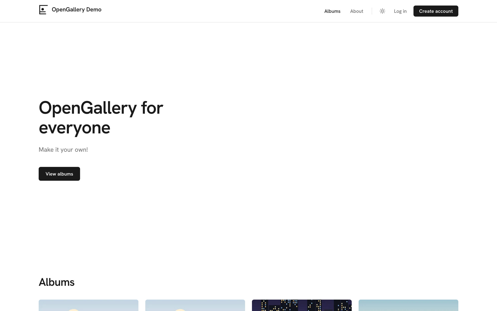
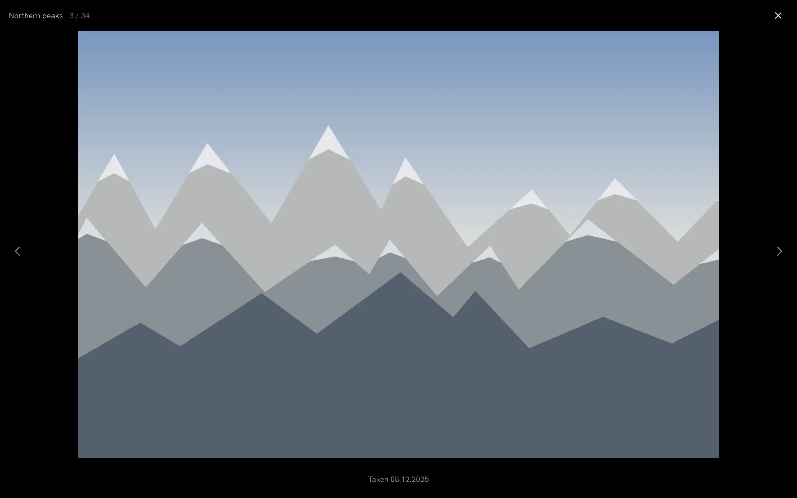
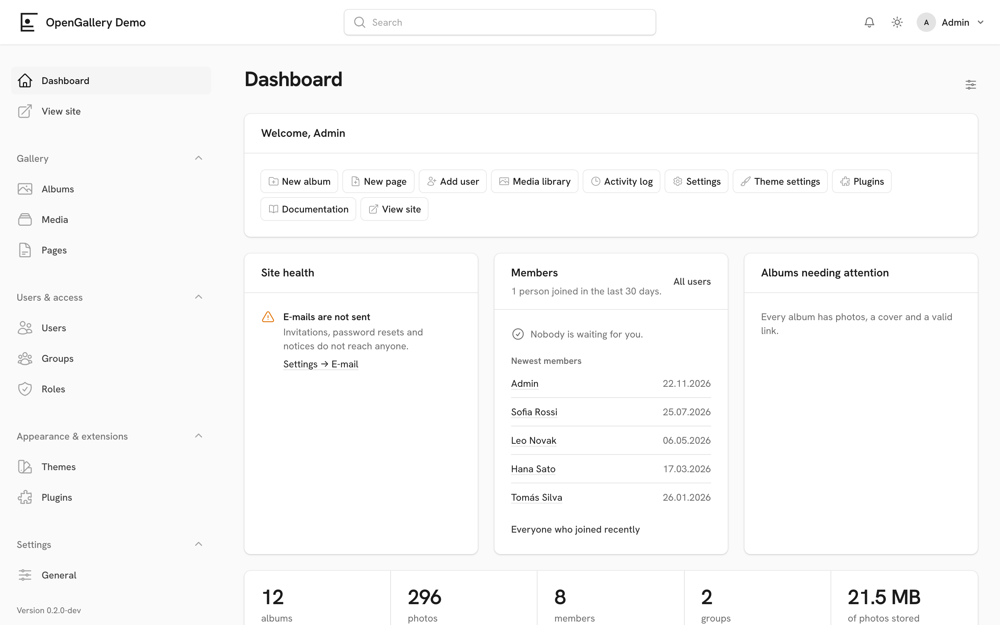
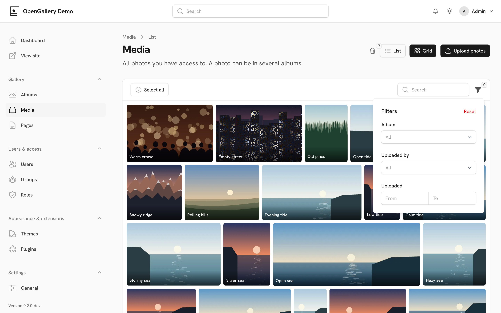
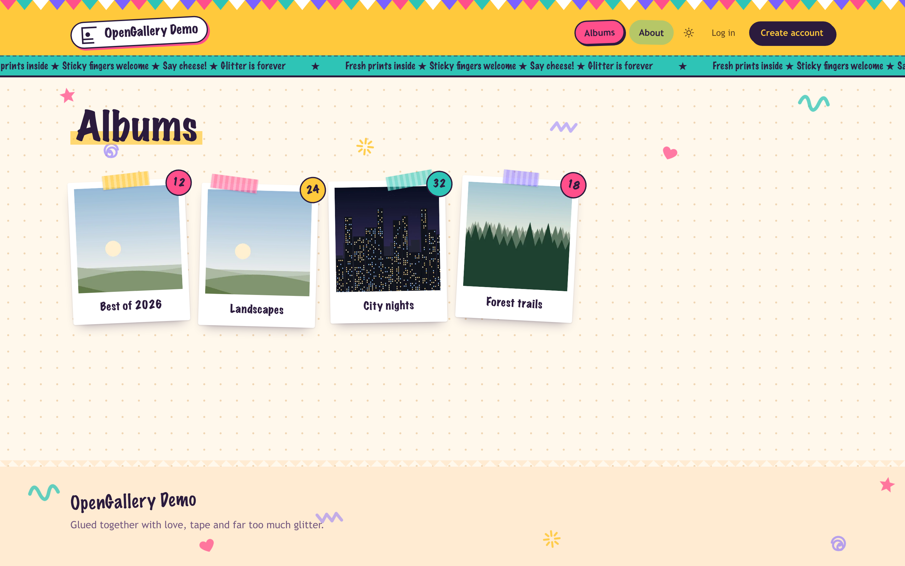

<picture>
  <source media="(prefers-color-scheme: dark)" srcset=".github/assets/logo-dark.svg">
  
</picture>

# OpenGallery

A self-hosted, privacy-focused photo gallery for individuals, families, clubs and organisations. It runs on ordinary PHP web hosting: no Docker, no Redis, no Node.js and no background worker on the server.

[Website](https://getopengallery.com) · [Download](https://github.com/getopengallery/opengallery/releases) · [Documentation](docs/README.md) · [Report a bug](https://github.com/getopengallery/opengallery/issues)

> OpenGallery is in early development (version 0.x). Back up your gallery before every upgrade.



## Screenshots

| Photo viewer | Admin dashboard |
| --- | --- |
|  |  |

| Media library | Scrapbook theme |
| --- | --- |
|  |  |

## Features

- **Albums and sub-albums** with five visibility levels: public, unlisted (link only), all members, specific users and groups, and private. Optional password and a "share until" date.
- **Sharing by e-mail** with people who have no account: they get a personal link and confirm it with a 6-digit code sent to them. Admins choose how many days guests keep access.
- **Photos** can be in several albums at once without copying files. Sort them by hand (drag and drop) or by date taken, upload date or name.
- **Photo viewer** with a slideshow, photo information (date taken and camera details) and downloads of single photos or whole albums, each of which admins can turn off.
- **Tags** for albums and photos, found by the site search.
- **Favorites**: members mark photos with a heart and find them again on their own page.
- **Media library** in the admin, as a list or a grid, with filters by album, uploader and date. Every photo chooser in the admin uses the same picker, with uploads included.
- **Uploads** in chunks, so large photos work with small PHP upload limits. Thumbnails and camera data are read automatically.
- **Collaboration**: invite people to work on an album with you.
- **Notifications** in the gallery and by e-mail when an album is shared with someone. Bulk e-mails go out in portions, so a host's sending limit is respected.
- **Roles and groups**: built-in roles and your own roles with fine-grained permissions. Groups decide who sees albums shared with an audience such as "Family" or "Scout leaders".
- **Content pages** such as an imprint, a privacy policy or "About us", with photos and small galleries.
- **Dashboard and activity log** of logins, album views and changes. No IP addresses or browser details are stored, and the log can be turned off.
- **Signed-in devices**: everyone sees where they are logged in and can sign other devices out.
- **Site settings** in the admin: name, logo, favicon, languages, e-mail, upload limits, registration, and what visitors see when public albums are off.
- **Installable web app** for the home screen of phones and computers.
- **Languages**: English and German included; every person can choose their own.
- **Updates from the admin** (optional): new stable or development versions are announced and can be installed in one click, with signature checks, a database backup and automatic rollback.
- **Themes and plugins**: included are the Default and Scrapbook themes and the **Identity providers** plugin for sign-in with OpenID Connect / OAuth 2.0 services such as Keycloak, Microsoft Entra ID, Google or GitHub.

## Installing

You need PHP 8.3 or newer with the `gd`, `exif`, `intl` and `zip` extensions, and a MySQL or MariaDB database.

1. Download `opengallery-<version>.zip` from the [latest release](https://github.com/getopengallery/opengallery/releases/latest). Do not use the "Source code" archive, which lacks the built styles and scripts.
2. Unpack it, upload the `opengallery` folder and point your domain's document root at its `public` folder.
3. Make `storage`, `bootstrap/cache` and the `opengallery` folder writable by the web server.
4. Open your gallery's address and follow the setup in your browser.

Shared-hosting details, the command-line install and upgrading are in [Installing and upgrading](docs/user/getting-started/installation.md).

## Local development

Requirements: PHP 8.3+ with `gd`, `exif`, `intl` and `zip`; Composer; Node `^20.19` or `>=22.12` (`nvm use`).

```bash
composer run setup            # composer install, .env, key, migrations, npm install and build
php artisan db:seed           # admin@example.com / password (super admin)
php artisan db:seed --class=DemoSeeder   # optional demo content
composer run dev              # PHP server, queue, logs and Vite together
```

- Site: http://localhost:8000, admin: http://localhost:8000/admin
- Tests: `php artisan test`; code style: `vendor/bin/pint`
- Releases: see [Releases and versions](docs/dev/contributing/releases.md)

Read [CONTRIBUTING.md](CONTRIBUTING.md) before opening a pull request.

## Stack

PHP 8.3+, Laravel 13, Filament 5, Spatie Laravel Permission, Spatie Media Library, Blade + Alpine.js + Tailwind CSS, MySQL/MariaDB (SQLite for development).

## Extending

- **Themes**: a folder in `themes/` with a `theme.json`. See [Themes](docs/dev/extending/themes.md) and [Blocks](docs/dev/extending/blocks.md).
- **Plugins**: a folder in `plugins/` with a `plugin.json` and a service provider. Copy `plugins/example` to start. See [Plugins](docs/dev/extending/plugins.md).
- **Translations**: see [Languages and translations](docs/dev/extending/translations.md).

## Roadmap

Ideas for later: a marketplace for themes and plugins, comments and reactions, video support, an API, cloud storage, WebDAV and federation.

## Security

Please report security problems privately, as described in [SECURITY.md](SECURITY.md).

## Licence

OpenGallery is free software under the [GNU Affero General Public License v3.0 or later](LICENSE). You may use it commercially, change it and sell services around it. If you distribute it, or let people use a changed version over a network, you must offer them its source code under the same licence. Third-party components are listed in [THIRD_PARTY_NOTICES.md](THIRD_PARTY_NOTICES.md).
