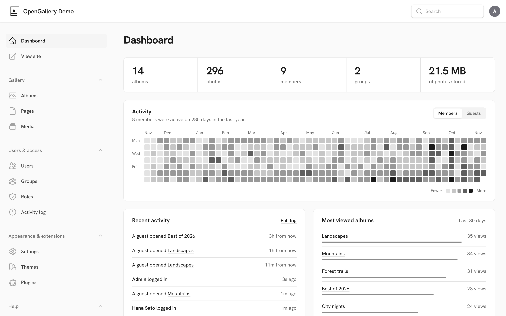
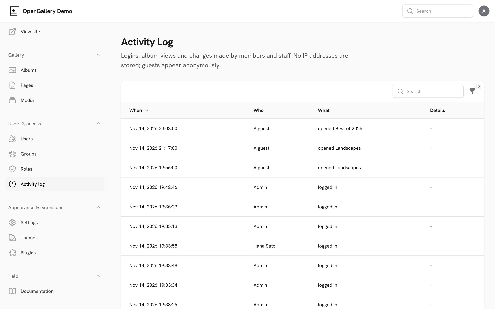

# Dashboard and activity log

The dashboard and the activity log show what is happening in your gallery. The dashboard's activity panels (library figures, activity calendar, trends, recent activity, most viewed albums) and the activity log need the permission "See the dashboard and activity log". The other panels of the dashboard depend on other permissions (see [The dashboard](dashboard.md)). What is recorded, and for how long, is set in the [site settings](settings.md#activity-log).

The gallery never stores IP addresses or browser details. Visitors who are not logged in are only counted anonymously per day.

Like most websites, the gallery keeps a session for every visitor while they browse. Sessions do not record IP addresses or browser details either, and they are removed some time after they expire (by default two hours without activity).

## The dashboard

These panels of the [dashboard](dashboard.md) read the activity log:

- **Library figures**: the number of albums, photos, members and groups, and how much storage the photos use. Click a figure to open its list, if you may open it.
- **Activity**: a calendar of the past year. Switch between members and guests to see when people were active.
- **Trends**: album views (by members and by guests) and logins per week for the last 12 weeks. Each starts with last week's number and how it compares to the week before; the current week is drawn hatched because it is not over yet.
- **Recent activity**: the latest logins, album views and changes, leaving out albums and photos you cannot open.
- **Most viewed albums**: the albums opened most often in the last 30 days, among those you may see.

 <!-- TODO: re-capture with the Trends panel and the new layout -->

Album views and logins only appear if the activity log records them. The figures are updated at most every ten minutes.

## The activity log

**System → Activity log** lists every recorded entry with **When**, **Who**, **What** and **Details**. It includes, depending on the setting:

- changes in the admin: albums, uploads, sharing, users, roles, groups, settings, themes and plugins;
- security events: failed logins, lockouts, password resets, wrong album passwords and linked sign-in accounts;
- logins of members;
- album views.

The **What** column uses these descriptions:

| Kind | What |
| --- | --- |
| Visits | Logged in, Opened album |
| Changes | Created, Changed, Deleted, Restored, Uploaded photos, Added photos, Removed photos, Reordered photos, Reordered albums, Changed settings, Activated theme, Turned plugin on, Turned plugin off, Uploaded theme, Uploaded plugin |
| Security | Failed login, Locked out, Reset password, Wrong album password, Linked sign-in account, Unlinked sign-in account |

**Details** says what was changed, for example which fields of an album or which people were added to a group. Passwords and other secret values are only recorded as "changed", never with their value.

Several changes to the same item by the same person within a short time are combined into one entry. If they cancel each other out (for example, a member removed and added again), no entry is kept.

Search the log by member name, or filter it with the funnel icon by **Kind** (visits, changes or security), **What** happened, **Who** (members or guests and system), a specific **Member**, or **When** (a date range).

## How long entries are kept

Entries older than the number of days set in **Keep entries for** are deleted automatically once a day. This is done by the [background jobs](settings.md#background-jobs). Turning the log off stops new entries, but existing ones stay until they expire.
