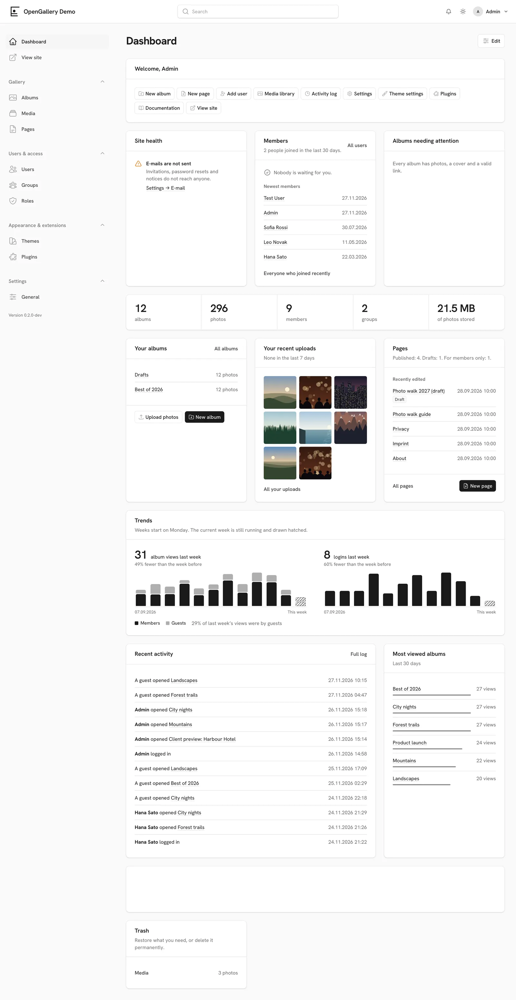
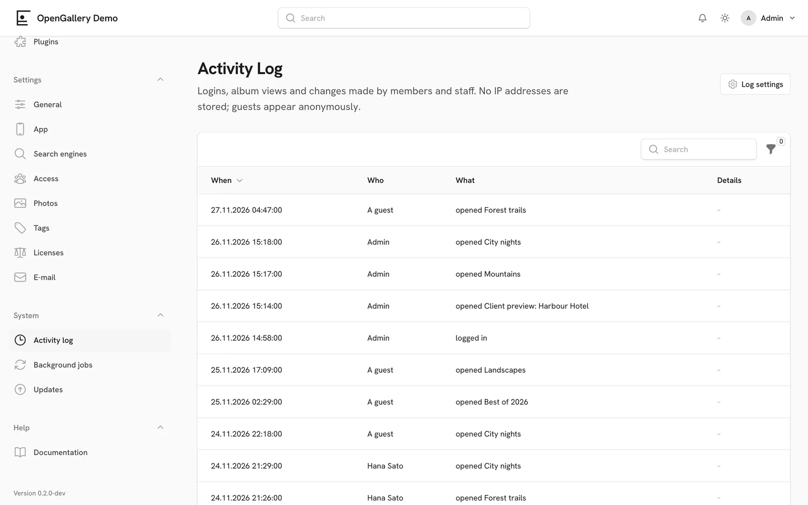

# Dashboard and activity log

The dashboard and the activity log show what is happening in your gallery. The dashboard's activity panels (library figures, trends, recent activity, most viewed albums) and the activity log need the permission "See the dashboard and activity log". The other panels of the dashboard depend on other permissions (see [The dashboard](dashboard.md)). What is recorded, and for how long, is set in the [log settings](settings.md#activity-log), opened with the **Log settings** button on the activity log.

The gallery never stores IP addresses or full browser details. Visitors who are not logged in are only counted anonymously per day.

Like most websites, the gallery keeps a session for every visitor while they browse. Sessions do not record IP addresses either. For logged-in people a session keeps only a short browser and system name, such as "Firefox on macOS", so they can recognise their devices (see [Where you're signed in](../members-and-visitors/profile.md#where-youre-signed-in)). Sessions are removed some time after they expire (by default two hours without activity).

## The dashboard

These panels of the [dashboard](dashboard.md) read the activity log:

- **Library figures**: the number of albums, photos, members and groups, and how much storage the photos use. Click a figure to open its list, if you may open it. The storage figure opens [Statistics](statistics.md) if you may see it.
- **Last week**: album views, downloads and logins of last week and how they compare to the week before.
- **Recent activity**: the latest logins, album views, downloads and changes, leaving out albums and photos you cannot open.
- **Most viewed albums**: the five albums opened most often in the last 30 days, among those you may see. **Show all** lists more.

For longer periods, charts, the activity calendar and more, see [Statistics](statistics.md).

Album views, downloads and logins only appear if the activity log records them. The figures are updated at most every ten minutes.

## The activity log

**System → Activity log** lists every recorded entry with **When**, **Who**, **What** and **Details**. It includes, depending on the setting:

- changes in the admin: albums, uploads, sharing, users, roles, groups, settings, themes and plugins;
- security events: failed logins, lockouts, password resets, wrong album passwords, wrong codes of guests invited by e-mail, linked sign-in accounts and people signed out of their devices;
- logins of members;
- album views;
- downloads of originals, as one photo or as a zip.

The **What** column uses these descriptions:

| Kind | What |
| --- | --- |
| Visits | Logged in, Opened album, Downloaded photo, Downloaded photos as zip |
| Changes | Created, Changed, Deleted, Restored, Uploaded photos, Added photos, Removed photos, Reordered photos, Reordered albums, Changed settings, Activated theme, Turned plugin on, Turned plugin off, Uploaded theme, Uploaded plugin |
| Security | Failed login, Locked out, Password reset, Wrong album password, Wrong guest code, Linked sign-in account, Unlinked sign-in account, Signed out sessions |

**Details** says what was changed, for example which fields of an album or which people were added to a group. Passwords and other secret values are only recorded as "changed", never with their value. "Signed out sessions" says how many devices were signed out; the entry names the person who did it, which is an administrator when they signed someone else out.

Several changes to the same item by the same person within a short time are combined into one entry. If they cancel each other out (for example, a member removed and added again), no entry is kept.

"Downloaded photo" and "Downloaded photos as zip" are recorded at the level **Everything**. A person counts once per photo or album and day; a zip of a selected set of photos counts every time, with the number of photos in **Details**. Downloads from your own profile are not recorded.

Search the log by member name, or filter it with the chips above the list by **Kind** (visits, changes or security; the visits filter reads "Visits (logins, album views, downloads)"), **What** happened, **Who** (members or guests and system), a specific **Member**, or **When** (a date range).

## How long entries are kept

Entries older than the number of days set in **Keep entries for** are deleted automatically once a day. This is done by the [background jobs](settings.md#background-jobs). Turning the log off stops new entries, but existing ones stay until they expire.
