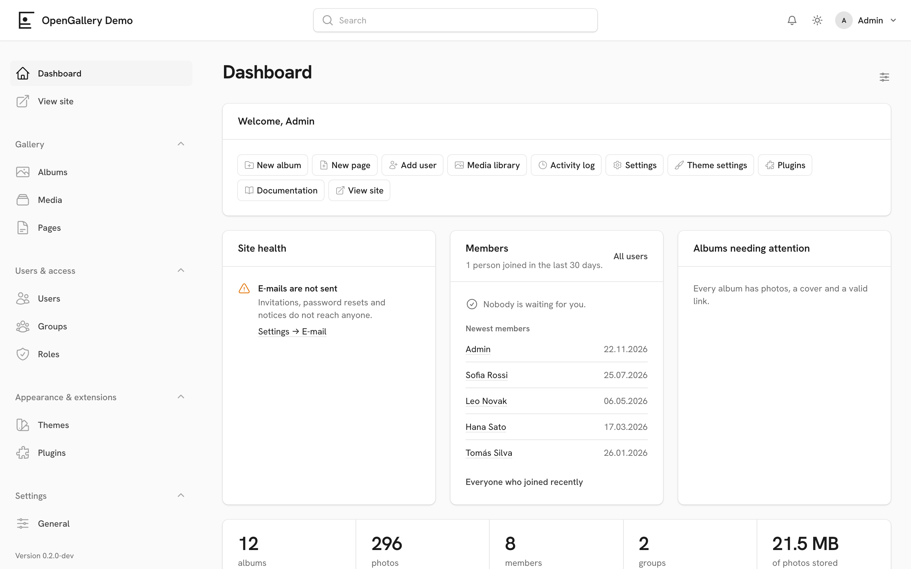
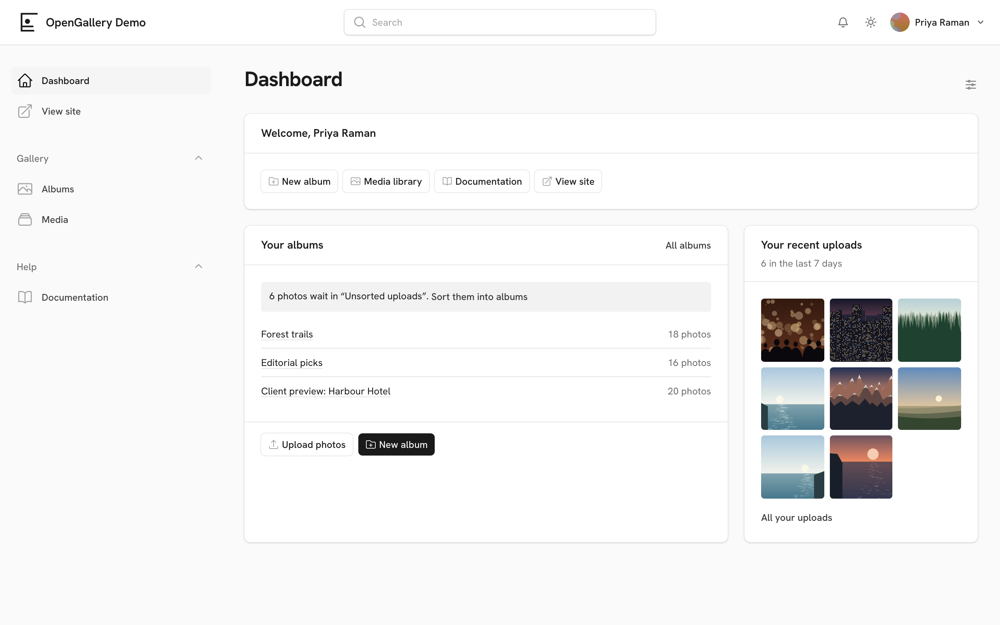
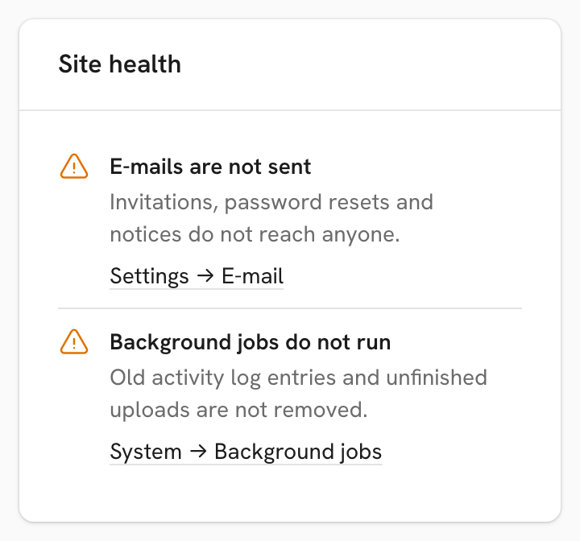
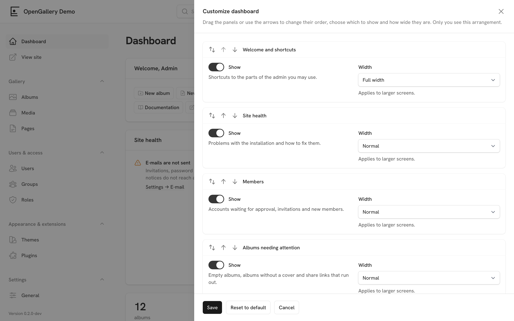

# The dashboard

The dashboard is the first page of the admin. It is made of panels, and each person sees only the panels that fit what they may do. Everyone who may open the admin gets at least the welcome panel, so nobody starts on an empty page. You can [arrange your own dashboard](#arranging-your-dashboard): change the order of the panels, hide some and choose how wide they are.

 <!-- TODO: screenshot of the dashboard as an administrator -->

## The panels and who sees them

| Panel | What it shows | Shown to people who may |
| --- | --- | --- |
| **Welcome** | Shortcuts to the parts of the admin you may use, such as **New album**, **New page**, **Add user**, **Settings** or **Activity log**, plus the media library, the documentation and the site | Open the admin area |
| **Your albums** | Your most recently changed albums, marked when a share link has expired or expires soon, how many photos wait in "Unsorted uploads", and the **Upload photos** and **New album** buttons | Create albums or upload photos |
| **Your recent uploads** | Your latest photos and how many you uploaded in the last 7 days | Upload photos |
| **Albums needing attention** | Albums that are empty, have no cover, or whose share link has expired or expires within 14 days | Edit every album |
| **Trash** | How many albums and photos you could restore from the trash. Only shown while there is something | Create albums, upload photos, edit or delete every album |
| **Site health** | Problems with the installation, each with a link to the setting or the instructions that fix it (see below) | Change site settings |
| **Members** | Accounts waiting for approval, open and expired invitations, unconfirmed e-mail addresses, new members of the last 30 days and the newest members | Manage users |
| **Pages** | How many pages are published, drafts or for members only, and the pages edited last | Edit pages |
| **Library figures** | The number of albums, photos, members and groups, and the storage the photos use | See the dashboard and activity log |
| **Activity**, **Trends**, **Recent activity**, **Most viewed albums** | When members and guests were active, album views and logins per week, the latest entries of the activity log and the most viewed albums (see [Dashboard and activity log](activity.md)) | See the dashboard and activity log |

## The standard arrangement for each role

Until you [arrange your dashboard](#arranging-your-dashboard) yourself, the panels come in an order made for what you do. What needs your attention comes first, then your own work, then the overview:

| Who | Order of the panels |
| --- | --- |
| **Administrators** | Welcome; site health, members and albums needing attention side by side; library figures; your albums, your recent uploads and pages; trends; recent activity and most viewed albums; activity calendar; trash |
| **Moderators** | Welcome; albums needing attention, your albums and your recent uploads; trends; recent activity and most viewed albums; library figures; activity calendar; trash |
| **Uploaders** | Welcome; your albums (wide) next to your recent uploads; trash |
| **Activity only** ("See the dashboard and activity log") | Welcome; trends; recent activity and most viewed albums; library figures; activity calendar |
| **Managing users** | Welcome; members (full width) |
| **Site settings** | Welcome; site health (full width) |
| **Editing pages** | Welcome; pages (full width) |

A [custom role](users-and-permissions.md#roles) gets the arrangement that covers most of its panels, leaving out the panels it may not see. For example, a role that uploads photos and edits pages gets the administrators' order: welcome, your albums, your recent uploads and pages in one row. A role that may only open the admin area sees the welcome panel, which says what such an account can do. The trash only appears while it holds something, at the place shown above.

 <!-- TODO: screenshot of the dashboard as an uploader -->

## Only what you may see

Panels never show more than the rest of the admin would show you:

- **Your albums**, **Your recent uploads** and the trash count only your own albums and photos, or what you may restore.
- **Most viewed albums** and **Recent activity** leave out albums and photos you cannot open. People who may see every album see them all. The full [activity log](activity.md#the-activity-log) is not filtered; it is meant for the people trusted with it.
- Names and albums link to the page where you can edit them if you may, otherwise to the album on the site, or to nothing.

## Site health

The **Site health** panel checks the installation each time the dashboard opens. The slower checks (database updates, background jobs that are waiting or failed, photos without thumbnails) are made by the [background jobs](settings.md#background-jobs) about every five minutes, so their results can be a few minutes old. When they find a new problem or warning, everyone who may change the site settings also gets a [notification](../members-and-visitors/notifications.md#problems-with-the-installation). It says **All checks passed** when everything is fine. Otherwise it lists:

- **The database needs an update**: an upgrade was not finished. See [Upgrading](../getting-started/installation.md#upgrading).
- **Photos cannot be saved**: the storage folder is not writable.
- **Debug mode is on**: visitors can see error details on a live site.
- **Thumbnails are not being made**: only with thumbnails made in the background; see [Thumbnails in the background](../getting-started/installation.md#thumbnails-in-the-background-optional).
- **Background jobs failed**: thumbnails made in the background, or [e-mails](settings.md#e-mail) the mail server kept refusing after several tries. Check the e-mail settings if you do not use background thumbnails.
- **Photos without thumbnails**: photos uploaded a while ago that still have no thumbnail.
- **Disk space is low**: less than 1 GB free on the server.
- **OPcache is off**: PHP prepares the gallery anew for every page, which makes the whole site slower. See [Speed](../getting-started/installation.md#speed).
- **Speed-up files cannot be saved**: the `bootstrap/cache` folder is not writable, so the gallery cannot keep its [prepared files](../getting-started/installation.md#prepared-files).
- **E-mails are not sent**: e-mail goes to the [test mailbox](settings.md#the-test-mailbox) or only to a log file.
- **Background jobs do not run**: the background jobs have not run for more than a day, or cron or webcron is chosen but has never started them. Old activity log entries and unfinished uploads stay. See [Background jobs](settings.md#background-jobs).
- **The activity log is off**: see [Activity log settings](settings.md#activity-log).
- **Update available**: a newer version of OpenGallery is out. A super administrator can install it under [Updates](settings.md#updates).

 <!-- TODO: screenshot of the site health panel with a warning -->

## Arranging your dashboard

Click the **Customize dashboard** button (the sliders icon) at the top right of the dashboard. A panel opens with every panel you may see:

- Drag a panel by its handle, or use the up and down arrows, to change the order. The arrows also work with the keyboard and on phones.
- Switch **Show** off to hide a panel.
- Choose a **Width**: **Normal** (one column), **Wide** (two columns) or **Full width**. On large screens the dashboard has three columns, on medium screens two; on phones every panel is one column wide.

Click **Save**. Only you see your arrangement; it does not change anyone else's dashboard and is not recorded in the activity log. **Reset to default** brings back all panels in their standard order and width.

 <!-- TODO: screenshot of the Customize dashboard panel -->

Your permissions always decide which panels you get. If you lose a permission, its panel disappears from your dashboard even if you arranged it; if you gain one, or a plugin adds a panel, it appears next to the panel it follows by default. If you hide every panel, the dashboard tells you how to show them again.

## Speed

Panels with figures for the whole gallery (library figures, activity, trends) are updated at most every ten minutes. The slower site health checks are made by the background jobs, not when the dashboard opens. The activity calendar and trends load right after the rest of the page, so the dashboard opens quickly even with a large library.
