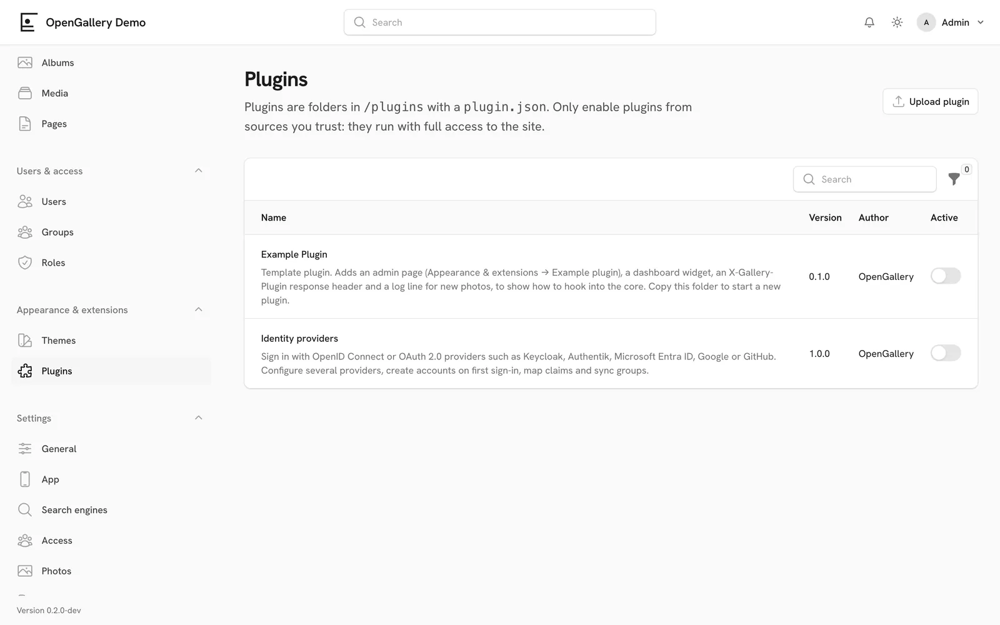
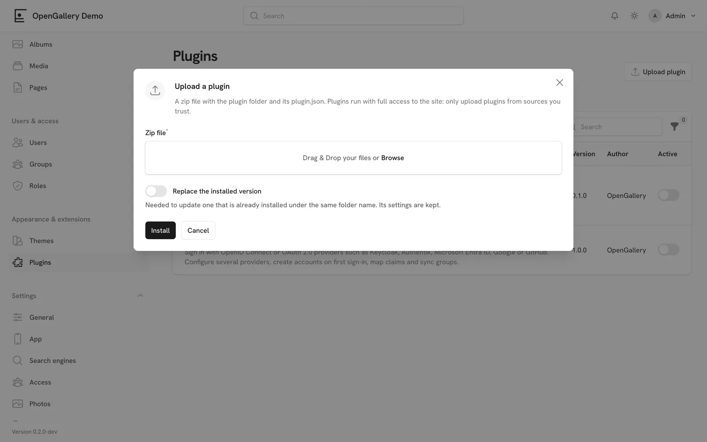
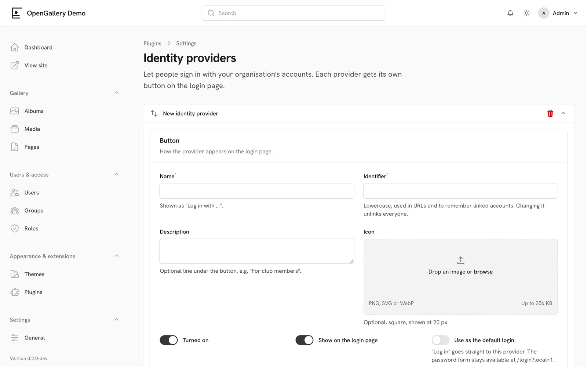

# Plugins and sign-in

Plugins add features to OpenGallery without changing its core. They are managed under **Appearance & extensions → Plugins** in the admin. You need the permission "Turn plugins on and off", and to [upload new plugins](#installing-a-plugin) also "Upload themes and plugins".

## Turning plugins on and off

The installed plugins are listed with their name and description, version and author (on a phone only the name and description). Use the **Active** switch in a plugin's row to turn it on or off; the page then reloads, so the plugin's settings and any pages it adds are there right away. On a live site the next page or two may load a little slower while the gallery prepares its [speed-up files](../getting-started/installation.md#prepared-files) again. Search the list by name or description, or filter it by **Status** with the funnel icon.

- A plugin with settings shows a gear icon in its row while it is on. Click the row (or the gear) to open its settings.
- Some plugins are switched on in the server configuration. Their switch is locked (hover over it: "Enabled in the server configuration"), and they cannot be turned off in the admin.

## Installing a plugin

Click **Upload plugin** at the top of the list and choose the plugin's zip file. The zip holds the plugin folder with its `plugin.json`, or the contents of that folder. Click **Install**: the plugin is added to the list and stays off until you turn it on.

- The folder name in the zip is the name the plugin is installed under. If the zip has no folder, the name of the zip file is used.
- To update a plugin, upload the new version and turn on **Replace the installed version**. Its settings are kept, and a plugin that was on stays on.
- Only install and turn on plugins from sources you trust: they have full access to the site. Uploading needs the permission "Upload themes and plugins". The button is not there without it, or when uploads are turned off in the [server configuration](../getting-started/installation.md#the-server-configuration-file).
- The zip may be at most 50 MB (less if your server limits uploads further) and must not hold more than 5,000 files. Zips with links or with files that would land outside the plugin folder are refused.

Instead of uploading, you (or your host) can also copy the plugin folder into the `plugins` folder of your installation.

## Included plugins

OpenGallery ships with two plugins:

- **Identity providers**: sign-in with external accounts, described below.
- **Example Plugin**: a starting point for developers who write their own plugins. While on, it adds an "Example plugin" page under **Appearance & extensions** for people who may manage plugins; visitors notice nothing. You can leave it off.

## Single sign-on

The **Identity providers** plugin lets people log in with an external account, for example Keycloak, Authentik, Microsoft Entra ID, Google, GitHub or any other OpenID Connect or OAuth 2.0 service. Turn the plugin on, reload the page and open its settings with the gear icon.

You can add several providers. For each one:

### Button

- **Name**: shown as "Log in with …".
- **Identifier**: lowercase, used in addresses and to remember linked accounts. Changing it unlinks everyone.
- **Description** and **Icon**: optional, shown with the button.
- **Turned on**, **Show on the login page** and **Use as the default login**. With a default login, "Log in" goes straight to that provider. The password form stays available at `/login?local=1`.

### Connection

The type of provider, its addresses (for OpenID Connect only the **Issuer URL**), the **Client ID** and **Client secret** (stored encrypted), and optional scopes. The form shows the **Redirect URI to register at the provider**: copy it into the provider's settings.

### Claims

Which information from the provider is used: how people are recognised (`sub` is safest), their display name, username, e-mail address, whether the e-mail is verified, and their groups. The defaults usually work.

### Accounts

- **Create an account when someone signs in for the first time**: works even if registration is closed in the site settings. New accounts get the default role.
- **Approve new accounts automatically**: shown while the option above is on. Accounts created through this provider skip the site's [administrator approval](settings.md#access). Accounts that are already waiting still need approval, and people whose e-mail address the provider does not confirm may still have to confirm it themselves. Turn this on only for providers you control: anyone who can sign in there gets into the gallery.
- **Connect to an existing account with the same e-mail address**: only when the provider confirms the address is verified. Turn this on only for providers you control: anyone who controls a matching, verified address there gets into that account.

### Groups

- **Update group membership on every sign-in**: keeps people's [groups](users-and-permissions.md#groups) in step with the provider, either with a mapping table or by matching group names.
- **Create groups that do not exist yet**: only when matching by group names.
- **Also remove people from groups the provider does not list**: only when matching by group names. At each sign-in, the person leaves every group the provider does not list, including groups you assigned by hand. If the provider sends no group list at all, nothing is removed.

People who already have an account can link a provider on their [profile](../members-and-visitors/profile.md#linked-accounts).
