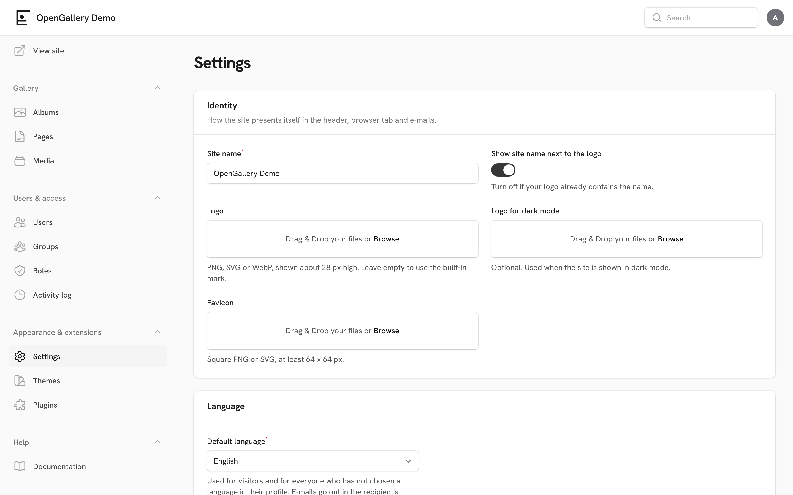
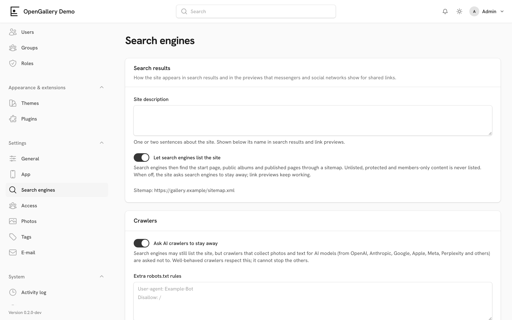
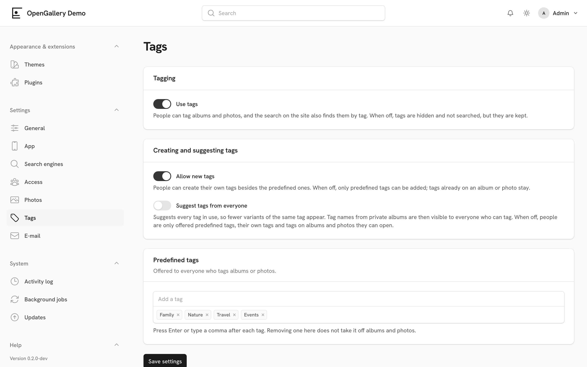

# Site settings

Site-wide settings are in the admin menu, with one page per topic. You need the permission "Change site settings". Every change is recorded in the activity log.

- **Settings**: [General](#general), [App](#app), [Search engines](#search-engines), [Access](#access), [Photos](#photos), [Tags](#tags), [Licenses](#licenses) and [E-mail](#e-mail).
- **System**: [Background jobs](#background-jobs) and [Updates](#updates). The [log settings](#activity-log) open with the **Log settings** button on the activity log.

Each page has its own **Save** button and saves only that page. If you try to leave a page with changes you have not saved, the browser asks first. To find a setting, type its name in the search field at the top of the admin, for example "favicon".

## Image fields

Logos, icons, background images and profile pictures in the admin all use the same field. It shows which formats and file size it accepts.

- **Add an image**: drop a file on the field, paste it, or click **browse**. On a phone, tap **Choose an image**.
- **While it uploads**: the image already appears, dimmed, and a thin line fills up. **Cancel** stops the upload.
- **Not saved yet**: the image is only used once you click the page's save button.
- **Replace**: choose another image. If the upload fails, the previous image stays.
- **Remove**: the image goes away when you save. Until then, **Undo** brings it back.

Logos are shown on a checkerboard so you can see transparent areas. The dark mode logo is always shown on a dark background.

## General

### Identity

How the site presents itself in the header, the browser tab and e-mails.

- **Site name**: shown in the header, in the browser tab and in e-mails.
- **Show site name next to the logo**: turn this off if your logo already contains the name.
- **Logo**: PNG, SVG, WebP or JPEG of up to 1 MB, shown about 28 pixels high. Without one, the OpenGallery mark is used; it switches to white in dark mode by itself.
- **Logo for dark mode**: optional, used when the site is shown in dark mode.
- **Favicon**: the small icon in the browser tab. A square PNG or SVG of at least 64 × 64 pixels (an ICO file works too), up to 256 KB. Without one, the OpenGallery mark is used.

### Language

- **Default language**: the language of the site, the admin and e-mails for visitors and for everyone who has not chosen a language in their own profile.

See [Languages](languages.md) for what is translated and how each person picks their own language.

## App

Visitors can install the site as an app: on a phone they add it to the home screen, on a computer they install it from the browser's address bar or menu. It then opens in its own window without the browser's bars, with your app icon (see [Installing the site as an app](../members-and-visitors/the-site.md#installing-the-site-as-an-app)).

- **Allow installing the site as an app**: on by default. Turn it off and browsers no longer offer to install the site; the offline helper on devices that installed it earlier removes itself on their next visit. Copies already installed then behave like a bookmark.
- **App icon**: only shown while the app is allowed. The icon on home screens and in app lists. A square PNG, WebP or JPEG of at least 512 × 512 pixels and up to 2 MB, without transparent areas (iPhones show them black). A picture that is not square is cut to a square from the middle. Without one, a favicon in PNG format is used, placed on white. With an SVG or ICO favicon, or none, the OpenGallery mark is used: white on a dark tile on iPhones and iPads, so it stays readable on dark home screens, and black on white everywhere else.

The browser bar of the app takes the header colour of the active theme, also in dark mode. The name under the icon is the **Site name**.

Photos and pages are never stored on the device. Only the site's styles, the logo and a short "You are offline" page are kept, so the app shows that page instead of a browser error when there is no connection.

## Search engines

How the site appears in search results (Google, Bing and others) and in the previews that messengers, chat apps and social networks show when someone shares a link.

### Search results

- **Site description**: one or two sentences about the site, up to 300 characters. Search results and link previews show it below the site name for the start page, and for pages without text of their own.
- **Let search engines list the site**: on by default. Search engines may then list the start page, public albums and published pages. They find them through a sitemap the gallery keeps up to date by itself; its address is shown below the switch. Unlisted albums, password-protected albums, albums for logged-in members and members-only pages are never listed, and their pages ask search engines not to keep them.

  Turn it off for a private site, for example a family gallery. Every page then asks search engines to stay away and the sitemap is gone. Link previews in messengers keep working.

### Crawlers

- **Ask AI crawlers to stay away**: on by default, only shown while search engines may list the site. Normal search engines may still list the site, but the crawlers that collect photos and text for AI models (from OpenAI, Anthropic, Google, Apple, Meta, Perplexity and others) are asked not to. Well-behaved crawlers respect this; it cannot technically stop the others.
- **Extra robots.txt rules**: optional lines added to the site's robots.txt as written, for example to keep out one more crawler. Most sites need nothing here.
- **robots.txt**: shows the file crawlers read, as it will look with the choices above. It updates while you change them; the site uses it once you save.

### Site verification

- **Google Search Console verification code** and **Bing Webmaster Tools verification code**: only shown while search engines may list the site. To see how your site does in Google or Bing, add it in [Google Search Console](https://search.google.com/search-console) or [Bing Webmaster Tools](https://www.bing.com/webmasters). When they ask how to confirm that the site is yours, choose the HTML tag method and paste the tag they show (or only the code inside it) here, save, and then click "Verify" there. Afterwards, submit the sitemap address shown under **Search results**.

### Link previews

When someone shares the address of an album or a page, the preview shows its title, a short description and a photo:

- **Public albums**: the album's cover photo (or its first photo).
- **Share links of unlisted albums**: the cover, blurred, with a link symbol in the middle.
- **Password-protected albums**: the cover, blurred so much that only its colours remain, with a lock symbol. The photo itself is never shown before the password is entered.
- **Pages**: the start of the page's text and the first photo placed on it.
- **Everything else** (start page, albums only members may see): the site name, the **Site description** and the **App icon** (see [App](#app)).

The symbols use the colours of the active theme. Messengers keep previews for a while. After changing a cover or the description, a link shared earlier may still show the old preview.

## Access

### Accounts

- **Allow people to create accounts**: when this is on, anyone can register on the site. New accounts get the role "user". When it is off, only administrators can add users. This also applies to sign-up through other login providers, unless a provider is set up to create accounts itself (see [Plugins and sign-in](plugins.md)).
- **New accounts need an administrator's approval**: only shown while sign-up is on. People who sign up can log in, but only see a "waiting for approval" page until someone who manages users approves them (see [Approving accounts](users-and-permissions.md#users)). Those people are always told about new accounts while this is on. Accounts from a sign-in provider set to [approve new accounts automatically](plugins.md#accounts) skip this.
- **Tell people who manage users when someone creates an account**: only shown while sign-up is on. Everyone with the permission "Manage users" (and super administrators) gets a [notification](../members-and-visitors/notifications.md) in the admin and, while e-mail works, a short e-mail, both with a link to the new account, so new members do not wait unnoticed.

### Visitors

- **Show public albums to visitors who are not logged in**: when this is off, albums marked "Public" can only be seen after logging in. Share links for unlisted albums and published pages keep working.
- **What visitors who are not logged in see**: only shown while public albums are off. Choose between:
  - **A landing page**: a welcome page whose text, image and layout you set in the theme settings (see [Themes](themes.md#landing-page)).
  - **The login page**.

### Guests

- **Allow sharing albums by e-mail with people without an account**: on by default. Albums shared with "Specific users & groups" can then be shared with e-mail addresses too. Those people, the guests, get a personal link and confirm each visit with a code sent to their e-mail address (see [Sharing with people without an account](../content/sharing.md#sharing-with-people-without-an-account)). The option to invite by e-mail only appears while [e-mail](#e-mail) works. Turning this off stops guests from opening albums; they get their access back when you turn it on again.
- **Days guests keep access**: only shown while sharing by e-mail is on. Counted from when the guest was added; 30 by default, 0 means no limit, at most 3650.

## Photos

### Albums

- **Sort photos in new albums by**: the photo order that is preselected when someone creates an album. Each album can still choose its own order, and existing albums keep theirs. See [Albums](../content/albums.md#photo-order).

### Uploads

- **Largest photo**: the biggest single photo that may be uploaded, in MB (50 MB by default, between 1 and 2048). Photos are sent in small pieces, so your host's upload limit does not matter here. Very large images still need enough server memory to make thumbnails (see [Large uploads](../getting-started/installation.md#large-uploads)).
- **Accepted file types**: which formats can be uploaded: JPEG, PNG, WebP, GIF, HEIC / HEIF and AVIF. Formats your server cannot turn into thumbnails are greyed out and cannot be chosen. HEIC, the format of many phone photos, usually needs a server with the Imagick extension.

### Compression

Off by default. With **Compress uploaded photos** on, new photos are made smaller to save storage. The smaller file replaces the original for good, and downloads give the smaller file too. Camera, date, location and colour profile details stay in the file, so [photo information](#photo-information) and **Remove location from downloads** keep working. Choose one or both parts:

- **Limit the resolution**: photos whose longest side is larger than **Longest side** are scaled down. The value is in pixels (3840 by default, between 640 and 20000). Smaller photos are never enlarged.
- **Lower the quality**: JPEG and WebP photos are saved again at **Quality**, in percent (80 by default, between 1 and 100). PNG files are lossless, so they are only scaled down.

GIF, HEIC, AVIF and animated WebP files are never changed. When the result would not be smaller, the original stays.

 <!-- TODO: screenshot of Settings -> Photos -> Compression with both parts on -->

Only photos uploaded after you save are compressed. Once compression is saved as on, **Compress existing photos** appears. After you confirm, the photos already stored are compressed with the saved settings, a few at a time by the [background jobs](#background-jobs), so these must be running. The section shows how many photos are still to be checked. The originals are replaced and cannot be restored. Photos that were already compressed with the same or stricter settings are skipped; if you lower the quality later, they are compressed again.

 <!-- TODO: screenshot of the Compress existing photos button and the remaining count -->

### Downloads

- **Albums can allow downloads**: off by default. While it is off, nobody can download photos or albums on the site: there is no download button in the photo viewer, no **Download all**, and visitors only get the photos in screen size. The **Visitors may download the photos** switch is then hidden in the album form. People who may edit a photo (its uploader, the people who manage its album and staff) still get the original, for example with **Download original** in the admin. When it is on, each album's own switch decides (see [Letting visitors download photos](../content/sharing.md#letting-visitors-download-photos)). When you update from an older version, it is turned on if any album already allowed downloads.
- **Remove location from downloads**: only shown while downloads are on, and on by default. Visitors get original photos without the GPS position saved by the camera or phone. The stored files do not change, and people who may edit a photo still get its position.

### Favorites

- **Users can favorite photos**: on by default. Logged-in people get a heart in the photo viewer on the site (see [The site](../members-and-visitors/the-site.md#albums-and-photos)), and their liked photos are collected in their own private **Favorites**. When off, the heart and the Favorites page are gone; the likes stay and come back when you turn it on again.

### Photo information

- **Show photo information**: on by default. An **i** button in the photo viewer shows the photo's description and camera details, and its [license](#licenses) while licenses are in use. The location is never shown there.
- **Below the photo**: what the photo viewer shows under each photo. The choices are:
  - **Description and date taken**: the default.
  - **Image name**: the photo's title, or its file name when it has no title. The file names of your photos are then visible to visitors.
  - **File name**: the name of the original file. Visitors can see it.
  - **Description**.
  - **Date taken**.
  - **License**: shown as a link to its text. Needs [licenses](#licenses) to be on; it does not depend on **Show photo information**.
  - **Camera and settings**: one line such as "Canon EOS R5 · 50 mm · f/1.8 · 1/200 s · ISO 100". Needs **Show photo information** to be on, and never shows the location.
  - **Nothing**.

  When a photo does not have the chosen detail, nothing is shown below it. Photos and galleries placed in a page do not show anything below the photo.

### Slideshow

- **Users can play a slideshow**: on by default. A play button in the photo viewer shows the photos one after another.
- **Seconds per photo**: how long each photo stays in the slideshow, 5 by default, between 2 and 60. Only shown while the slideshow is on.

## Tags

How people label albums and photos. See [Tags](../content/tags.md) for how tagging works.

- **Use tags**: on by default. When off, the tag fields are hidden and the search ignores tags. Existing tags are kept and come back when you turn it on again.
- **Allow new tags**: on by default. When off, people can only add predefined tags. Tags already on an album or photo stay.
- **Suggest tags from everyone**: off by default. When on, everyone who tags sees every tag in use, which helps avoid several versions of the same tag. Tag names from private albums are then visible to them. When off, people see predefined tags, their own tags and tags on albums and photos they can open.
- **Predefined tags**: tags offered to everyone, up to 200. Removing one here does not take it off albums and photos.

## Licenses

Which license a photo carries, for example "CC BY 4.0" or "All rights reserved". See [Licenses](../content/licenses.md) for how people give photos a license and where it is shown.

 <!-- TODO: screenshot of Settings → Licenses with licensing on -->

- **Use licenses**: off by default. When on, every new photo gets the default license, the photo page shows a **License** field and the photo information in the viewer shows the license. When off, licenses are hidden, but photos keep theirs and they come back when you turn it on again.
- **Default license**: only shown while licenses are on, and required. New uploads get this license; photos uploaded before keep theirs, or stay without a license. Below the field you see the selected license's description in plain words and a **Read the license** link to its full text. The default license cannot be deactivated or deleted.
- **Uploaders choose the license**: on by default. People who may edit a photo can then give it another license. When off, new photos always get the default license and nobody except people with the permission "Change site settings" can change it.
- **Licenses to choose from**: only shown while uploaders may choose. A checkbox list of the active licenses, each with its description in plain words. The default license can always be chosen. People with the permission "Change site settings" can always pick any active license, even with choosing turned off.

The **Edit licenses** button at the top opens the list of licenses.

### The list of licenses

The list is opened from this page and is not in the menu; it needs the permission "Change site settings". Click a license to edit it, or **New license** to add one. Each license has:

- **Short name**: shown next to the photo, for example "CC BY 4.0".
- **Full name**: shown when pointing at the short name.
- **Link to the license text**.
- **Description**: what others may do with a photo under this license, in plain words. People see it while choosing a license.
- **Position**: licenses are listed from the lowest number.
- **Active**: inactive licenses cannot be chosen any more; photos that have one keep it.

OpenGallery comes with these licenses: All rights reserved, CC BY 4.0, CC BY-SA 4.0, CC BY-ND 4.0, CC BY-NC 4.0, CC BY-NC-SA 4.0, CC BY-NC-ND 4.0 and CC0 1.0. Their full names and descriptions are translated into the languages of the site; texts you write yourself are shown as written, in every language. Sites that update from an older version get the same licenses.

A license can only be deleted while no photo uses it, trashed photos included; otherwise deactivate it. The default license can be neither deactivated nor deleted: choose another default first. Creating, changing and deleting licenses is recorded in the [activity log](activity.md).

## E-mail

The gallery sends e-mails such as password reset links, invitations to new users, notices when an album is shared with someone, and (if turned on under [Access](#access)) notices about new accounts. They go out in each recipient's language. While e-mail works, people who sign up (or change their address) must confirm it with a link before they use the gallery. To try all of this before you have a mail server, choose **Test mailbox** (see below).

### Delivery

- **Send e-mail through**:
  - **Server configuration**: uses the mail settings from the `.env` file on the server. This is the default.
  - **SMTP server**: the mail server of your host or e-mail provider. This is the most reliable choice. Fill in the **SMTP server**, **Port**, **Encryption** (STARTTLS for port 587, SSL/TLS for port 465), **User name** and **Password**. Your provider's help pages list these values.
  - **This web server (sendmail)**: the mail program installed on the server. It works on many shared hosts, but messages often end up in spam.
  - **Test mailbox (nothing is sent)**: for trying things out without a mail server. E-mails are kept in the gallery instead of being sent, and everything that needs e-mail (confirming addresses, invitations, notices) works as if they had been sent. A warning reminds you that nobody receives anything. Super administrators read the kept e-mails under **System → Test mailbox** (see [The test mailbox](#the-test-mailbox)). Switch to a real delivery before other people use the gallery: until then nobody gets password reset links or confirmation e-mails.
- **Password**: stored encrypted. Once saved, it is never shown again. Leave the field empty to keep the saved password. Clearing the user name also removes the password.
- **SMTP server** and **Port** (1 to 65535) are required for SMTP; **User name** and **Password** only if your provider asks for them.
- **E-mails per hour**: the most e-mails the gallery sends in one hour (200 by default). Enter the limit of your host or e-mail provider. Notices that can go to many people, such as a shared album, wait and are sent in portions by the [background jobs](#background-jobs), so a large group can take several hours. If any are waiting, the field shows how many. Password reset links, invitations and notices about a changed password or e-mail address are never held back. A refused e-mail is tried again several times over about seven hours.

### Sender

- **Sender address**: the address e-mails come from. Many providers only deliver mail from an address of your own domain. Leave it empty to use the server configuration.
- **Sender name**: the name shown as the sender. Leave it empty to use the site name.
- **Send a test e-mail**: sends a short message to your own e-mail address with the values currently in the form, even before you save them. If it fails, the error from the mail server is shown. With "Test mailbox", the message goes there instead.

### The test mailbox

**System → Test mailbox** lists the e-mails kept while **Send e-mail through** is set to **Test mailbox**: subject, recipient and when. Click one to read it as the recipient would see it. Its links work; to act as the recipient (for example to accept an invitation or confirm an address), open the link in a private browser window, so you are not logged in as yourself.

Only super administrators can open the test mailbox, because its e-mails contain working password reset and invitation links for other people's accounts. The newest 100 e-mails are kept, for 7 days at most. **Delete all** empties it. The entry disappears from the navigation once the mailbox is off and empty.

Older versions offered "Do not send (write to the log file)" here. Sites that used it were switched to the test mailbox when upgrading.

## Activity log

What the dashboard and the activity log record, and for how long. The activity log stores no IP addresses (see [Dashboard and activity log](activity.md)).

To open these settings, go to **System → Activity log** and click **Log settings**. If you may change settings but not read the log, **Log settings** is listed directly under **System**.

- **Record**: how much is recorded. Each level includes the ones before it.
  - **Off**: nothing new is recorded. Existing entries stay until they expire.
  - **Changes only**: changes made in the admin and security events, such as failed logins, lockouts, password resets and wrong album passwords.
  - **Changes and logins**: also when members log in.
  - **Everything**: also album views. Visitors who are not logged in are counted anonymously per day.
- **Keep entries for**: how many days entries are kept (365 by default, between 1 and 3650). Older entries are deleted once a day by the [background jobs](#background-jobs).

See [Dashboard and activity log](activity.md) for what you can do with the recorded entries.

## Background jobs

Regular housekeeping: deleting activity log entries that are older than **Keep entries for**, removing uploads that were interrupted and never finished, making the small thumbnails phones use for photos uploaded before they existed, repeating the slower [site health](dashboard.md#site-health) checks about every five minutes (and telling the people who change settings about new problems), removing [notifications](../members-and-visitors/notifications.md) older than 180 days, [checking for new versions](#updates) if turned on, sending [e-mails that wait](#e-mail), and making thumbnails that wait in the background (only if your server is set up to [make thumbnails in the background](../getting-started/installation.md#thumbnails-in-the-background-optional)). The clean-ups run at most once a day, the thumbnails every time.

The page shows when the background jobs last ran and what started them.

- **Start background jobs with**:
  - **AJAX (with page views)**: the default. When someone opens a page of the site or the admin and the last run is more than 5 minutes ago (1 minute while thumbnails are made in the background or e-mails wait), their browser starts a run without slowing the page down. Needs no setup, but nothing happens while nobody visits the site.
  - **Webcron**: for hosts without cron jobs. Enter the **Webcron address** shown below the choice in a webcron service (for example your host's or cron-job.org) and let it open the address every 5 to 15 minutes. The address only works while Webcron is chosen and saved. Keep it to yourself; if it gets out, click **New address**: the old one stops working at once, and you enter the new one in your webcron service.
  - **Cron**: the most reliable choice, if your host offers cron jobs. Copy the line shown under **Cron job** into your hosting panel. Panels that ask for the times separately need "every minute" and only the command after the five stars.
- While Cron or Webcron is chosen but has not started the background jobs in the last hour, a warning says so.

A cron job that is set up always runs the background jobs, whichever option is chosen. However often they are started, they run at most once a minute. If they have not run for more than a day, the dashboard shows a warning (see [Site health](dashboard.md#site-health)).

## Updates

The gallery can tell you when a new version of OpenGallery is out, and a super administrator can install it here. Nothing is downloaded or installed until someone clicks **Install update**. See [Installing an update from the admin](../getting-started/installation.md#installing-an-update-from-the-admin).

- **Check for new versions**: once a day, the [background jobs](#background-jobs) ask GitHub for the list of OpenGallery releases. GitHub sees your server's address. Nothing about your gallery, its people or its photos is sent. A gallery set up in the browser asks you during setup; otherwise this is off until you turn it on.
- **Update channel**:
  - **Stable**: finished versions for everyday use. This is the recommended choice.
  - **Development**: also tells you about test versions. They can contain errors, so use them only on a gallery you can restore.

The page shows the installed version and when the last check ran. The version number links to that release on GitHub and opens in a new tab. A development copy of the code that has no release of its own shows the version as plain text. **Check now** asks right away. When a newer version is available, the page offers **Install update** and links to its release, the bottom of the admin menu shows **Update to** with the version below the installed version, and [Site health](dashboard.md#site-health) shows a note.

While update checks are on, the installed version at the bottom of the admin menu links to this page. With checks off the page is not available and the version is plain text.

If you move a gallery from Development back to Stable, it stays on its version until a newer finished version is out.
