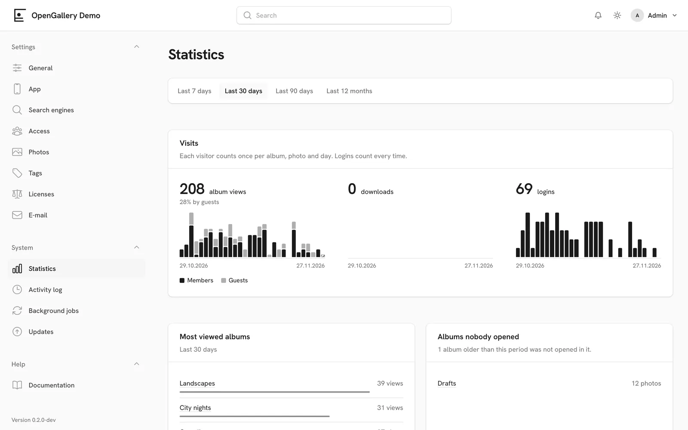
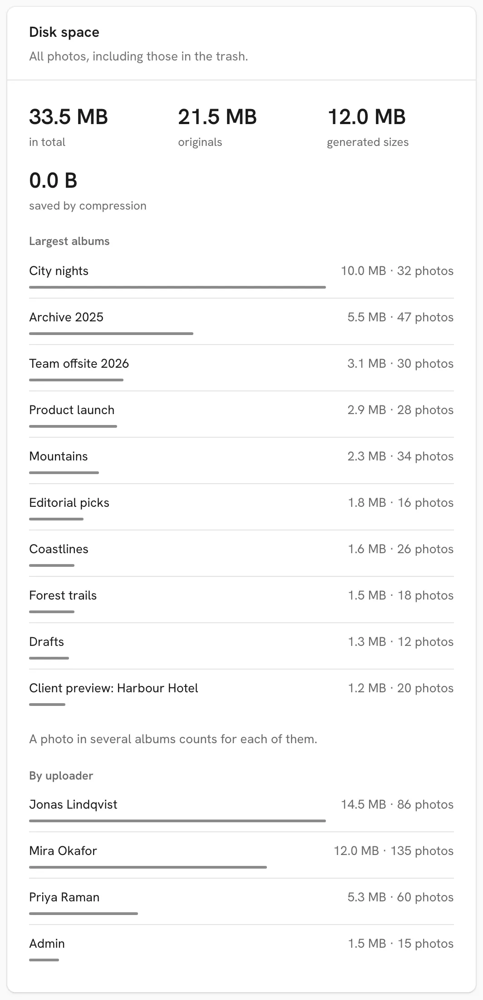

# Statistics

**System → Statistics** shows figures for the whole gallery: how often albums are opened and photos downloaded, how much disk space the photos use, how the library grows, how active the members are and who can see what. The [dashboard](dashboard.md) shows short summaries of some of them and links here.

You need the permission "See the statistics" (in the group "Admin area" when you [edit a role](users-and-permissions.md#permissions)). Administrators have it by default, moderators do not, and super administrators always do. Without it the page is not in the menu.

## The period

The tabs at the top choose the period for the figures that depend on one: **Last 7 days**, **Last 30 days**, **Last 90 days** and **Last 12 months**. The charts show one bar per day for 7 and 30 days, one per week for 90 days and one per month for 12 months. The chosen period is part of the page address, so you can bookmark or share it with other administrators.

## Visits

Album views by members and by guests, downloads and logins, each as a chart with the total for the period. Each visitor counts once per album, photo and day; logins count every time.

These figures come from the [activity log](activity.md), so they depend on its settings:

- Album views and downloads are only recorded at the level **Everything**. At a lower level the page says so and the figures stay empty (at **Changes and logins**, only logins are counted).
- Entries are deleted after the number of days set in **Keep entries for**. If the period is longer than that, the page tells you that older visits are no longer counted.

See [Activity log settings](settings.md#activity-log) to change both.

## Activity calendar

A calendar of the past year, moved here from the dashboard. Switch between **Members** and **Guests** to see on which days people were active.

## Most viewed albums and albums nobody opened

- **Most viewed albums**: the albums opened most often in the period, with their views and zip downloads.
- **Albums nobody opened**: albums older than the period that nobody opened in it. Useful to find albums that can be tidied up or removed. Without recorded album views this list cannot be made.

Albums you may edit link to their editor, the others to the album on the site.

## Most downloaded photos

The photos whose originals were downloaded most often in the period.

## Disk space

- **In total**, split into the **originals**, the **generated sizes** (the smaller versions the site shows) and what **compression** saved. Photos in the trash are included.
- **Largest albums**: a photo that is in several albums counts for each of them, so the albums add up to more than the total.
- **By uploader**: who uploaded how much.

Two notes can appear:

- Sizes of the generated versions of older photos are measured in the background, a few hundred at a time, by the [background jobs](settings.md#background-jobs). Until that is done, the page says so and the figures are still too low.
- Photos that were compressed before the gallery recorded their original size cannot count towards what compression saved.

## Growth

Photos, albums and members added in the period, and a chart of the total number of photos over time.

## Member activity

How many members logged in during the last 7, 30 and 90 days, how many have not been seen for over 180 days and how many never logged in. Below, the least active members, each linking to the person's account if you may manage users. The last login of every member is stored on each login, whatever the activity log level is; for accounts that existed before, it was filled in from the logins in the activity log.

## Who can see what

An overview of what people without an account can reach: the number of photos anyone can see without logging in, the albums open to everyone, the albums with a password, the guest invitations, the albums by visibility and the albums whose access has expired. When public albums are turned off in the [settings](settings.md), the page says that visitors who are not logged in see no albums. Members' personal albums and the trash are not counted.

## How current the figures are

Figures are kept for about ten minutes, so a new upload or login can take a while to show up.

## Downloads in the activity log

Downloads are recorded in the [activity log](activity.md#the-activity-log) at the level **Everything**: **Downloaded photo** for one original and **Downloaded photos as zip** for the zip of an album or of a selection, with the number of photos. A person counts once per photo or album and day; a zip of a selection counts every time. Downloading your own photos from your profile is not counted.
