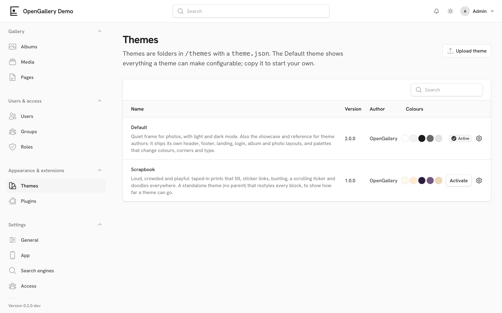
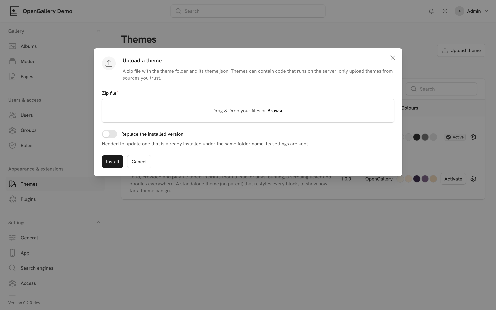
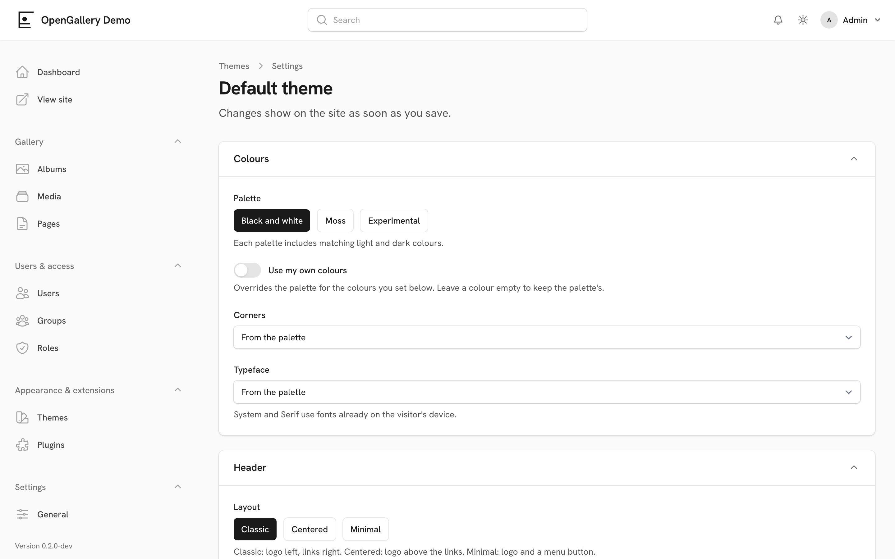
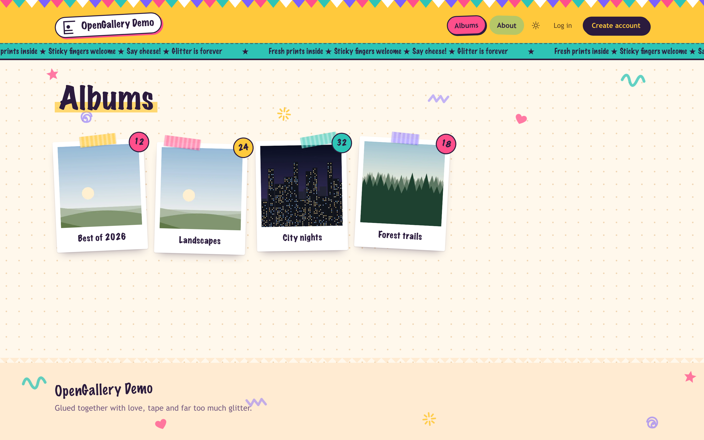

# Themes

A theme decides how the site looks. Themes are managed under **Appearance & extensions → Themes** in the admin. You need the permission "Choose and set up themes", and to [upload new themes](#installing-a-theme) also "Upload themes and plugins".

The admin area follows the active theme's colours and corner style too.

## Choosing a theme

The installed themes are listed like plugins, with their name and description, a preview of their colours, version and author (on a phone only the name and description). Exactly one theme is in use at a time: it is listed first and marked **Active**. Click **Activate** in another theme's row and confirm to use that one instead. Visitors see the new look right away; the theme that was active before is switched off and the page reloads, so the admin takes on the new colours too. Each theme keeps its own settings, so you can switch back at any time.

A theme with settings has a gear icon in its row. Click the row (or the gear) to customize the theme. This works for inactive themes too, so you can prepare a theme before switching to it.

## Installing a theme

Click **Upload theme** at the top of the list and choose the theme's zip file. The zip holds the theme folder with its `theme.json`, or the contents of that folder. Click **Install**: the theme is added to the list, but the active theme stays in use until you activate the new one.

- The folder name in the zip is the name the theme is installed under. If the zip has no folder, the name of the zip file is used.
- To update a theme, upload the new version and turn on **Replace the installed version**. Its settings are kept.
- Themes can contain code that runs on the server: only upload themes from sources you trust. Uploading needs the permission "Upload themes and plugins". The button is not there without it, or when uploads are turned off in the [server configuration](../getting-started/installation.md#the-server-configuration-file).
- The zip may be at most 50 MB (less if your server limits uploads further) and must not hold more than 5,000 files. Zips with links or with files that would land outside the theme folder are refused.

Instead of uploading, you (or your host) can also copy the theme folder into the `themes` folder of your installation.

## What a theme can change

A theme is more than a set of colours. Besides colours, corners and typeface, it can bring its own layouts for the header, footer, landing page, login page, album lists and photo grids, its own settings, different wording, and its own look for error pages ("Page not found") and the e-mails the gallery sends.

Each theme decides which of these it offers, so the settings page looks different from theme to theme. Settings you save belong to one theme: switching to another theme and back keeps them.

## Customizing the Default theme

The Default theme shows what themes can do and has the settings below. Other themes may offer different ones. Click **Save** when you are done, or **View site** to check the result.

### Colours

- **Palette**: a set of matching light and dark colours:
  - **Black and white**: a quiet frame that never tints your photos.
  - **Moss**: muted greens.
  - **Experimental**: an orange header in the colour of the OpenGallery logo, warm paper, orange buttons, rounder corners and a serif typeface. It shows that a palette can change more than colours.
- **Use my own colours**: set your own colours for light and dark mode. Colours you leave empty keep the palette's.
- **Corners**: From the palette, Square, Slightly rounded or Rounded.
- **Typeface**: From the palette, Hanken Grotesk, System or Serif. System and Serif use fonts already on the visitor's device.

Corners and Typeface start at "From the palette", so a palette like Experimental can bring its own. Pick a value to use it with every palette.

### Header

- **Layout**: Classic (logo left, links right), Centered (logo above the links) or Minimal (logo and a menu button).
- **Pages in the header**: which [pages](../content/pages.md) to link.
- **Show the light/dark switch**: lets visitors switch between light and dark mode.
- **Keep the header visible while scrolling**: the header stays at the top of the window on long pages.

### Footer

- **Layout**: One line, Columns or No footer.
- **Text**: for example a short description, a copyright line or contact details.
- **Pages in the footer**: for example your imprint and privacy policy.

### Albums

- **Album tiles**: Grid (up to four albums per row) or Large (two per row, with bigger covers).
- **Photo layout**: Justified rows (each photo keeps its shape, rows of equal height) or Square crops (a uniform grid).

### Landing page

The landing page is shown to visitors who are not logged in while public albums are turned off and the [site settings](settings.md#access) choose "A landing page".

It can also open the home page while the albums are listed there, for example when public albums are on. The landing page then fills the top of the home page, its button **View albums** leads down to the album list, and the albums follow below it. Only the first page of the album list starts with it.

- **Show above the album list**: Never (the default), To visitors who are not logged in, or To everyone.
- **Layout**: Text only, Text and image, or Full-screen image.
- **Heading**: leave empty to use the site name.
- **Text**: above the album list, an empty text is simply left out.
- **Image**: used by the two image layouts. Landscape photos work best.
- **Show "Create account"**: only shown while registration is open.

### Login and registration

- **Layout**: Centered, Form and image, or Form on an image.
- **Image**: used by the two image layouts.
- **Caption on the image**: optional, for example "Photos of the club since 1987".

### Custom CSS

Add your own CSS to fine-tune the site. It applies to the site only, not to the admin area.

## Customizing the Scrapbook theme

Scrapbook is the loud opposite of the Default theme: photos taped in at an angle like prints in a scrapbook, links on colourful stickers, bunting along the top, a scrolling ticker under the header and doodles everywhere. Use it for a playful site, or to see how differently a theme can present the same albums.

It changes some wording on the site too, for example an empty album says "Nothing glued in here yet. Bring the glitter!".

### Colours and paper

- **Palette**: Bubblegum (pink, yellow header), Lemonade (greens and yellow) or Circus (red header, chunky lettering). Each one also sets the sticker, tape and doodle colours, in light and dark mode.
- **Use my own colours**: set your own page colours. Sticker colours always come from the palette.
- **Corners**: From the palette, Snipped, Rounded or Bubbly.
- **Headline lettering**: From the palette, Handwritten, Rounded or Chunky serif. These use fonts already on the visitor's device, so headlines look a little different on each device.
- **Paper**: the page background: Dotted, Grid paper, Confetti or Plain.

### Whimsy

- **Tilt photos and albums**: prints sit a little crooked and straighten up when you point at them.
- **Scatter doodles**: stars, hearts and squiggles around titles, the footer and the login page.
- **Show the scrolling ticker under the header**, with your own **Ticker text** (leave empty for the theme's).

Turn these off for a calmer site that keeps the colours.

### Header, footer and albums

- **Pages in the header**, **Show the light/dark switch** and **Keep the header visible while scrolling** work as in the Default theme.
- **Footer**: a **Text** (leave empty for the theme's own line) and **Pages in the footer**.
- **Photo layout**: Pile (each photo keeps its shape, in crowded columns) or Polaroid wall (square prints with the photo titles written underneath).

### Landing page, login and custom CSS

- **Landing page**: Heading, Text, Image (taped into a collage next to the text) and Show "Create account".
- **Note under the form**: a short line under the login and registration forms.
- **Custom CSS**: as in the Default theme.
