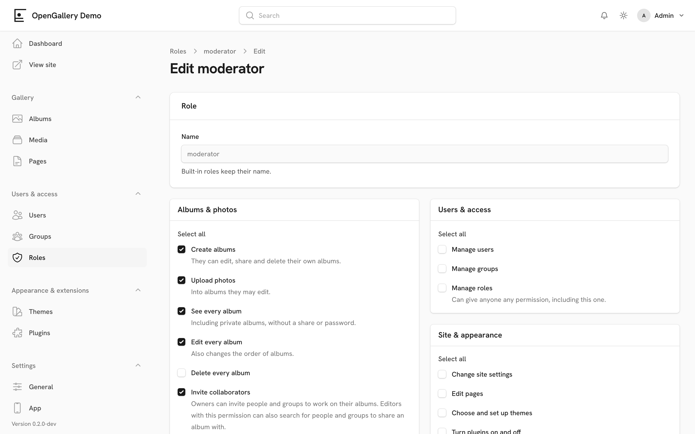

# Users, roles and groups

People are managed under **Users & access** in the admin:

- **Roles** decide what someone may do on the whole site, for example create albums or change settings.
- **Groups** decide which shared albums someone can see, for example "Family" or "Scout leaders".

## Users

Under **Users & access → Users** you can add, edit and remove accounts. You need the permission "Manage users".

"Manage users" never gives more rights than you have yourself:

- In **Roles** you can only choose roles whose permissions you have yourself. Only super administrators can give the role "Super admin".
- You can only edit or delete accounts whose roles you could give yourself. Accounts with more rights than yours, such as super administrators, have no edit button for you, and deleting several users at once skips them.

Super administrators can do all of this for every account.

For each user you can set:

- **Picture**, **Name**, **E-mail address** and **Password** (at least 12 characters; leave it empty when editing to keep the current one).
- **Send an invitation** (new users only): instead of choosing a password for the person, e-mail them a link to choose their own. The link works for 7 days; opening it, they set a password and are logged in, and their e-mail address counts as confirmed. While e-mail is set up this is on by default. Without working e-mail, or if sending fails, the gallery shows you the link so you can pass it on yourself.
- **E-mail verified at**: when the e-mail address was confirmed. People you add count as confirmed (the field is filled in for you), and so do accounts that existed before e-mail confirmation was introduced. While e-mail works, people without a date only see the "confirm your address" page after logging in; clear the field to make someone confirm their address again.
- **Language**: the language the user sees and gets e-mails in. Leave it empty to follow the site's default language (see [Site settings](settings.md#language)). Users can change it themselves in their profile.
- **Roles**: what the user may do on the site.
- **Groups**: which albums shared with groups the user can see.

People who register on the site themselves get the role "user". If you want to hear about them, turn on the e-mail about new accounts in the [site settings](settings.md#access).

**Approving accounts**: while **New accounts need an administrator's approval** is on in the [site settings](settings.md#access), people who sign up wait until someone who manages users approves them. The number next to **Users** in the navigation shows how many are waiting, and the filter **Waiting for approval** lists them (their e-mail address is marked "Waiting for approval"). Click **Approve** in their row, at the top of their page, or for several selected people at once. They are told by e-mail and can use the gallery right away. The "waiting for approval" [notification](../members-and-visitors/notifications.md) is then marked as read for everyone who manages users.

**Send password link** at the top of a user's page e-mails them a new link to choose a password, for example when an invitation expired or someone is locked out. Earlier links stop working; their current password keeps working until they choose a new one.

**Sessions**: the tab **Sessions** on a user's page lists the browsers where that person is logged in, with a short name such as "Firefox on macOS" and when each was last active. **Sign out** in a row logs that browser out; **Sign out everywhere** at the top logs out all of them, including browsers where the person chose "Remember me". You only see the tab for people you may edit (see above), and only while the gallery keeps its sessions in the database, which is the default. The person is told in the gallery and by e-mail that you signed them out, and the action appears in the [activity log](activity.md). People can do the same for themselves in their [profile](../members-and-visitors/profile.md#where-youre-signed-in).

**Deleting a user** (the red icon in their row, or **Delete** at the top of their page) never deletes their albums. If the person owns albums, the confirmation lists them and asks for a **New owner of the albums**:

- By default that is you. Search for anyone else by name or e-mail address; the people being deleted cannot be chosen.
- Clear the field ("Nobody") to move their albums to the trash instead. Albums in the trash have no owner; when you restore one, give it an **Owner** in the album's settings.

The same applies when you delete several users at once: all their albums go to the one new owner, or to the trash. Their "Unsorted uploads" and "Page images" are merged into the new owner's own (see [System albums](../content/albums.md#system-albums)). Without a new owner, "Unsorted uploads" goes to the trash like their other albums, while "Page images" stays where it is without an owner, because its photos are shown on pages.

People can also delete their own account in their profile. There, albums they own are deleted with the account if they confirm it (see [Deleting your account](../members-and-visitors/profile.md#deleting-your-account)).

Search the list by name or e-mail address, or filter it by **Role**, **Group**, **E-mail address** (verified or not) and **Registered** (a date range). See [Searching and filtering lists](../getting-started/admin-area.md#searching-and-filtering-lists).

## Roles

Under **Users & access → Roles** you can change what each role may do, and create your own roles. You need the permission "Manage roles". The list shows how many permissions each role has and who holds it. To find the roles of one person, filter the list by **Held by**.

Open a role to tick its permissions. They are grouped like in the list below; **Select all** and **Deselect all** switch a whole group at once.

Below the form, **Users with this role** lists who has it: search for people to add them, or use **Remove role**.

- The built-in roles keep their names and cannot be deleted. Roles you created yourself can be renamed and deleted.
- You can change the permissions of the built-in roles; upgrading OpenGallery keeps your changes and only adds permissions that are new in that version (see [Upgrading](../getting-started/installation.md#upgrading)). The table below shows the standard set.

These roles are built in:

| Role | What it is for |
| --- | --- |
| Super admin | Everything. Its permissions cannot be changed. |
| Admin | Every permission. |
| Moderator | The admin area, the dashboard and activity log, seeing and editing every album, creating albums, uploading photos and inviting collaborators. |
| Uploader | The admin area, creating albums, uploading photos into their own albums and inviting collaborators to them. In the admin they only see their own albums. |
| User | No extra permissions: sees public albums, albums for all members and albums shared with them or their groups. |

The person created during installation is a super admin.

### Permissions

Albums and photos:

- **Create albums**: they can edit, share and delete their own albums.
- **Upload photos**: into albums they may edit.
- **See every album**: including private albums, without a share or password.
- **Edit every album**: also changes the order of albums.
- **Delete every album**
- **Invite collaborators**: owners can invite people and groups to [work on their albums](../content/sharing.md#working-on-an-album-together). Editors with this permission can also search for people and groups to share an album with.

Admin area:

- **Open the admin area**: needed for every other admin permission. Without it, someone who [works on an album](../content/sharing.md#working-on-an-album-together) still gets a reduced admin with only **Albums**.
- **See the dashboard and activity log**: the activity panels of the [dashboard](dashboard.md) and the full activity log. The log names every album and member it mentions, including private albums, so give this permission only to people you trust with that.

Users and access:

- **Manage users**
- **Manage groups**
- **Manage roles**: can give anyone any permission, including this one. Give it only to people you fully trust.

Site and appearance:

- **Change site settings**
- **Edit pages**
- **Choose and set up themes**
- **Turn plugins on and off**: plugins can add login methods and other features.
- **Upload themes and plugins**: install new [themes](themes.md#installing-a-theme) and [plugins](plugins.md#installing-a-plugin) from zip files, together with one of the two permissions above. Uploaded themes and plugins run code on the server, so give this only to people you trust fully.

## Groups

Under **Users & access → Groups** you create groups for audiences such as "Family" or "Club members". You need the permission "Manage groups".

A group has a name and an optional description. Open a group to manage its **Members**: search for people to add, or remove them. You can also choose a person's groups in their account under **Users & access → Users**. To find the groups of one person, filter the list by **Member**. Albums with the visibility "Specific users & groups" can be shared with a group, so everyone in it can see the album (see [Sharing albums](../content/sharing.md)). A group can also be invited to [work on an album](../content/sharing.md#working-on-an-album-together): its current members then have that role.

When you add members to a group, **Tell people when they get access** is on. Everyone who can now see more albums gets one [notification](../members-and-visitors/notifications.md) and, while e-mail works, one e-mail. In a person's account under **Users & access → Users**, the same switch is off until you turn it on.

Groups can also be filled automatically when people sign in through an identity provider (see [Plugins and sign-in](plugins.md#single-sign-on)). Nobody is told in that case.
