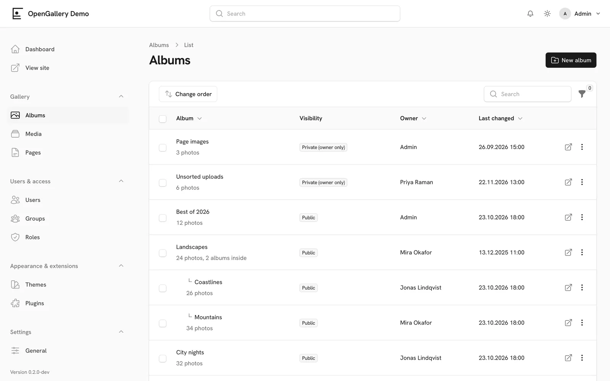
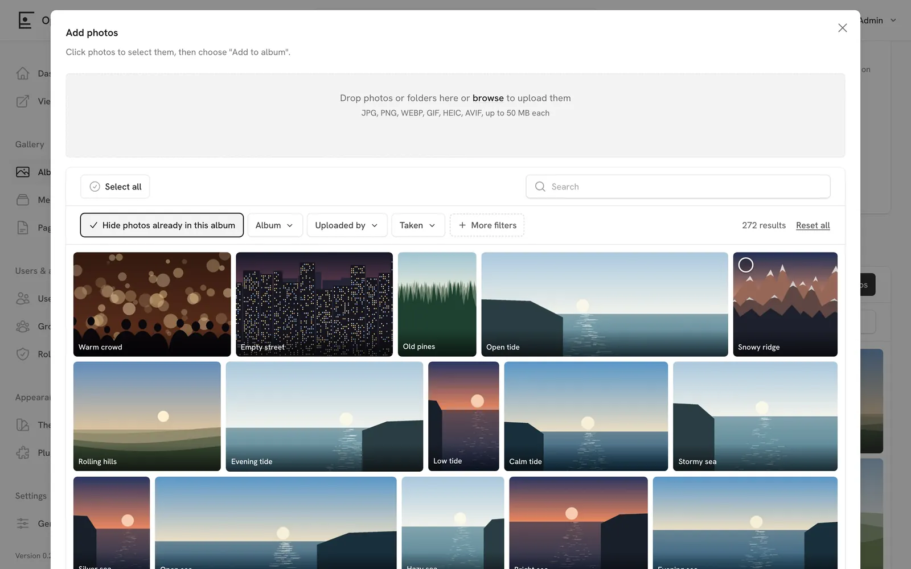
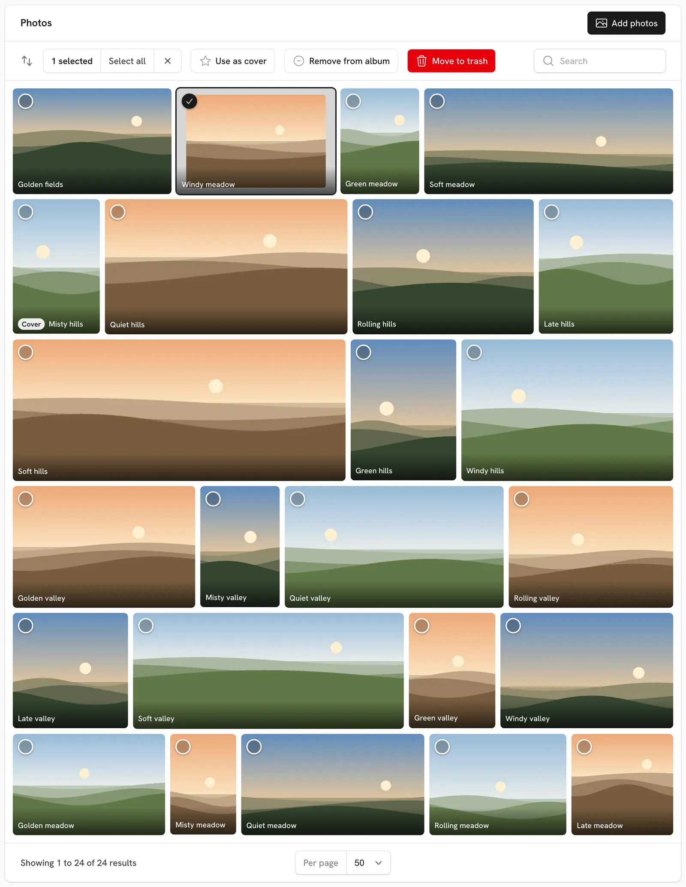

# Albums

Albums hold your photos. They can be nested, so an album can contain other albums, and the same photo can be in several albums at once without being copied.

Albums are managed under **Gallery → Albums** in the admin. To create albums you need the permission "Create albums". You can always edit, share and delete albums you own, and invite others to [work on them with you](sharing.md#working-on-an-album-together).

## The albums list

People with the permission "See every album", "Edit every album" or "Delete every album" see every album here. Everyone else sees the albums they own and the albums they work on as a [collaborator](sharing.md#working-on-an-album-together); albums only shared with them are opened on the site.

The list shows albums as a tree: albums inside another album appear indented below it, with the number of photos and albums they contain. Sorting by another column or searching switches to a flat list that shows each album's full path.

Click a row to open the album and edit it. Each row also has:

- **View on site**: view the album as visitors see it.
- **Add album inside**: create a new album inside this one (in the row's menu).
- **Move to trash** (in the row's menu).

The album's own page in the admin also has an **View on site** button at the top (not while the album is in the trash).

Search the list by title, or filter it by **Visibility**, **Owner** (only shown to people who see every album) and **Last changed**, a date range (see [Searching and filtering lists](../getting-started/admin-area.md#searching-and-filtering-lists)). Albums in the trash are not in this list; see [Deleting and restoring albums](#deleting-and-restoring-albums).

## Creating an album

Click **New album** in the albums list or **New album** on your "My albums" page on the site. The page has the same cards as an album's edit page. Fill in:

- **Title** and an optional **Description**, both shown on the site.
- **Tags**: labels that help people find the album and its photos. With **Also apply these tags to sub-albums**, the albums inside it get them too. See [Tags](tags.md).
- **Inside album**: choose a parent album, or leave it at "None (top level)". You can choose your own albums; with "Edit every album", any album.
- **Owner**: the person the album belongs to. Only shown to people with "Edit every album", who can give an album to someone else; everyone else always creates albums as themselves.
- **Visibility & sharing**: who may see the album. See [Sharing albums](sharing.md).
- **Photos**: choose the first photos from the library or upload new ones. You can add more later.
- **Sort photos by**: see [Photo order](#photo-order).
- **Cover**: the photo shown on the album's tile. Without one, the first photo is used.
- **Collaborators**: people and groups who work on the album with you, with their role (see [Working on an album together](sharing.md#working-on-an-album-together)).

## Adding photos

Open the album and scroll to the **Photos** section below the form. Click **Add photos** to open the media picker. On the site, people who may add photos to an album see an **Add photos** button at the top of the album's page, which opens the album here with the picker already open. In the picker you can:

- drop new photos, or whole folders of photos, on the upload area (or browse for them). They are uploaded straight into this album and selected for you;
- choose photos that are already in the library, filtered by album, uploader or upload date with the funnel icon, the same filters as in the media library. The filter "Hide photos already in this album" is on when the picker opens; remove it to see every photo.

The upload area lists the file types and the largest size this gallery accepts (see [Site settings](../administration/settings.md#uploads)).

You can upload thousands of photos in one go. A progress bar shows how many photos and how much data are done. The grid stays still while you upload, and the new photos appear in it, already selected, when the upload has finished. If the connection drops for a moment, the upload carries on where it stopped. Files that could not be added (for example, a file that is not a photo) are listed with the reason when the upload ends. Keep the window open until the upload is done; **Cancel** stops it, and photos already uploaded are kept.

Click **Add to album** to add the selected photos from the library. Photos you uploaded are already in the album, even if you close the picker without clicking it. To add photos you need the permission "Upload photos" and must be allowed to edit the album. Collaborators use this same section with what their role allows; see [Working on an album together](sharing.md#working-on-an-album-together).

Photos you upload in the picker of a new album (before it is created) or when choosing a cover are kept in your private album "Unsorted uploads" until they join an album (see [System albums](#system-albums)). They leave it as soon as they are added to another album, wherever you do that: in an album, in the media library or in the photo's own form.

## Managing the photos of an album

In the **Photos** section, click photos to select them, or use **Select all**. The button in the corner of each photo opens it in the media library. A **Cover** badge marks the album's cover. With photos selected you can:

- **Use as cover**: select exactly one photo to make it the album cover.
- **Remove from album**: the photos stay in the media library and in their other albums. A photo that is only in this album is kept; move it to the trash instead if you want it gone.
- **Move to trash**: removes the photos from every album they are in. You can restore them from the trash in **Media**. See [Photos and the media library](photos.md#the-trash).

## Photo order

**Sort photos by** decides the order of photos on the site and in the Photos section:

- **Manual (drag to reorder)**: click the arrows button at the top left of the Photos section, drag photos into the order you want, and click the button again when you are done.
- **Date taken**, oldest or newest first.
- **Upload date**, oldest or newest first.
- **Name**, A to Z or Z to A.

The preselected order for new albums is set in [Site settings](../administration/settings.md#albums).

## Album order

Top-level albums are shown on the home page in a fixed order, and albums inside another album in the same way on its page. To change it, click **Change order** in the albums list, drag albums into place and click **Done**. You can only reorder albums at the same level this way; to move an album somewhere else, change its **Inside album** setting. Changing the order needs the permission "Edit every album".

## The cover

Choose the cover in the **Cover** section with **Choose cover**, or select a photo in the Photos section and click **Use as cover**. If you choose a photo from elsewhere in the library, it is added to this album too, so visitors can see it. When the cover photo is removed or moved to the trash, the album automatically gets a new one.

## Deleting and restoring albums

**Move to trash** (at the top of the album's page, or in the row's menu in the albums list) moves an album to the trash. Albums in the trash are hidden on the site. While the trash holds albums, a trash can button with their number (**Trash**) appears above the albums list. It opens the trash, where each album has **Restore** and **Delete permanently**, also for several selected albums at once. **Back to Albums** returns to the list. Restoring and deleting need the same right: you own the album, or you have the permission "Delete every album".

- Albums inside it go to the trash with it. Restoring the album brings them back too, except albums that were already in the trash before.
- Photos stay visible as long as they are in at least one album that is not in the trash. Photos that are only in this album (or in albums inside it) are hidden on the site until you restore it. The confirmation says how many albums and photos this concerns.
- In the media library, such photos show **Not on the site** on their tile, and in the list their albums are marked "(in the trash)".
- Clicking an album in the trash opens its page read-only: you can look at its settings and photos, but change nothing until you restore it.
- **Delete permanently** removes the album for good. Albums inside it move up one level. The confirmation says how many photos are in no other album: by default they move to the album owner's "Unsorted uploads" (see [System albums](#system-albums)), so nothing is lost. Tick **Delete these photos permanently instead** to remove them too; photos used on a page are always kept. Photos uploaded by the album's collaborators are never deleted this way: they move to the uploader's own "Unsorted uploads". Deleting several albums at once works the same way.

## System albums

Everyone who uploads photos gets two private albums of their own, created when they are first needed:

- **Unsorted uploads**: photos uploaded in the media picker before they were added to an album. They leave it as soon as they are added to another album.
- **Page images**: photos uploaded while writing pages. They are shown on those pages even though this album is private. See [Pages](pages.md).

They appear among your own albums in the albums list, so you can sort your unsorted uploads from there; others only see them with the permission "See every album". When an administrator deletes your account and gives your albums to someone else, the photos in these two albums join that person's own "Unsorted uploads" and "Page images". If a system album is moved to the trash, it is restored automatically the next time it is needed.
