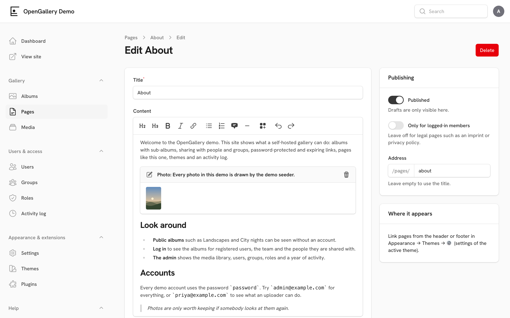

# Pages

Pages are simple content pages, such as an imprint, a privacy policy or an "About us" page. They are managed under **Gallery → Pages** in the admin. You need the permission "Edit pages".

The pages list can be searched by title and filtered by **Published** (published pages or drafts) and **Who can see it** (everyone or members only).

## Writing a page

Click **New page** and fill in:

- **Title**: shown at the top of the page.
- **Content**: written in the editor. You can use two levels of headings, bold and italic text, links, bulleted and numbered lists, quotes and dividers, and insert photos (see below).

In the **Publishing** section:

- **Published**: drafts are only visible in the admin.
- **Only for logged-in members**: leave this off for legal pages such as an imprint or privacy policy.
- **Address**: the page appears at `/pages/` followed by this address. Leave it empty to use the title.

Published pages are visible even when public albums are turned off for visitors, unless they are for members only. While a page is published, **View on site** at the top of its edit page shows it as visitors see it.

## Photos on a page

In the editor, insert one of two blocks:

- **Photo**: a single photo. Choose it with **Choose photo**, and optionally add a caption (up to 200 characters) and pick the width: "Same width as the text" (the default) or "Wide".
- **Gallery**: several photos. Add them with **Add photos**; they appear in the order you add them. Then choose the layout ("Grid" of equal squares, the default, or "Rows", which keeps each photo's shape like in albums), 2, 3 or 4 photos per row (3 by default), a caption and the width ("Wide" by default).

Photos can be picked from the media library or uploaded while you write. Uploaded photos are kept in your private album "Page images". You can only use photos you may see yourself: your own uploads, photos in your albums, in albums shared with you or your groups, and in albums for everyone or all members. People with the permission "See every album" can use every photo. If a page contains a photo you may not use, it cannot be saved until you remove it. Photos someone else placed on the page earlier may stay.

Visitors can click the photos to view them larger. A photo you place on a published page can be seen there by everyone who can see the page, even if its album is private. It does not make the rest of the album visible.

## Deleting a page

**Delete** at the top of the page's form, the red icon in its row in the list, or **Delete** for several selected pages removes them for good: pages have no trash. To take a page offline but keep it, turn off **Published** instead. Photos used on a deleted page stay in the media library.

## Linking pages from the header and footer

Pages are not linked anywhere automatically. Choose which pages appear in the header and footer in the theme settings: **Appearance & extensions → Themes**, then click the active theme's row (see [Themes](../administration/themes.md#header)).

Only published pages can be linked.
