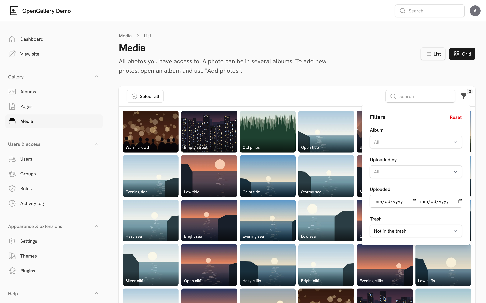
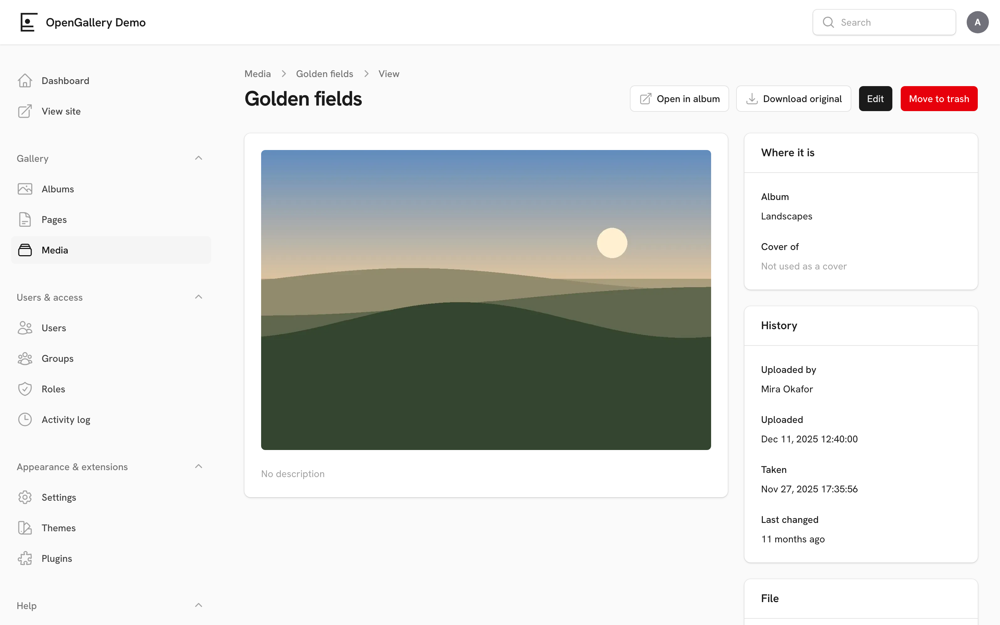

# Photos and the media library

The media library under **Gallery → Media** lists every photo you have access to, across all albums. A photo can be in several albums at once; it is stored only once.

New photos are usually uploaded inside an album: open the album and use **Add photos** (see [Albums](albums.md#adding-photos)). You can also upload here: see [Uploading in the media library](#uploading-in-the-media-library). When photos are uploaded, OpenGallery creates thumbnails and reads the camera data (such as the date taken) automatically.

## Uploading in the media library

Click **Upload photos** at the top (you need the permission "Upload photos"). First choose where the photos go in **Upload to**: "Unsorted uploads" (the default; sort them into albums later) or one of the albums you may add photos to. Click **Continue**, drop the photos on the upload area, and click **Done** when the upload has finished.

The **Upload photos** button on the dashboard opens the same dialog.

## List and grid

The media library opens as a grid. Switch between the two layouts with the **List** and **Grid** buttons at the top. Your choice is remembered until you log out.

- **List** shows each photo's thumbnail, title and file name, albums (albums in the trash are marked "(in the trash)"), uploader, upload date and size. Photos without a title show "Untitled", and photos that are in no album at all show "In no album" (this should not happen in normal use; add such a photo to an album or move it to the trash). More columns, such as the date taken, can be turned on in the column menu. Click a row to open the photo; the icons at the end of the row view it, edit it or move it to the trash.
- **Grid** shows the photos in rows of equal height, like an album on the site: every photo keeps its shape, so upright photos are shown upright and nothing is cut off. An album's edit page and the photo picker show photos the same way, with the title on the photo. Hover over the title to see the albums the photo is in. A tile marked **Not on the site** belongs only to albums that are in the trash, so visitors cannot see it until one of them is restored. Click a photo to select it; each tile has its own button to open the photo.

## Finding photos

Search by title, or open the filters with the funnel icon (see [Searching and filtering lists](../getting-started/admin-area.md#searching-and-filtering-lists)):

- **Album**
- **Uploaded by**
- **Uploaded**: a date range

Photos in the trash are not in the media library; they have their own page (see [The trash](#the-trash)).

The filters are the same in the list and the grid, and in the photo picker of an album.

## Working with several photos

Select photos (in the list with the checkboxes, in the grid by clicking them or with **Select all**), then choose:

- **Add to album**: adds the photos to another album, without copying them.
- **New album from selection**: creates a private album of yours with the selected photos (you enter its title) and opens it, where you can choose its cover and how it is shared. Needs the permission "Create albums".
- **Remove from album**: removes them from one album. A photo that would end up in no album is kept; move it to the trash instead.
- **Move to trash**.

In the trash, the choices are **Restore** and **Delete permanently**.

## A single photo

Opening a photo shows a large preview and its details:

- **Where it is**: its albums, and which albums use it as the cover.
- **History**: who uploaded it, when, when it was taken and when it was last changed.
- **File**: name, type, size and dimensions.
- **Camera**: the camera data stored in the file, if any.

From here you can **Open in album** (on the site), **Download original** (only if you may edit the photo, or one of its albums lets visitors download photos), **Edit**, or **Move to trash**. For a photo in the trash, the page says since when and offers **Restore** and **Delete permanently**.

When editing, you can change the **Title**, **Description**, the **Taken** date (useful when the camera clock was wrong) and the **Albums** the photo is in. Every photo must stay in at least one album. The photo can be seen by anyone who can see one of its albums.

## Who may change a photo

- You can edit a photo you uploaded, or a photo in an album you may edit.
- You can move a photo to the trash if you uploaded it, or if you may edit every album it is in.
- You can only add photos to albums you may upload to, and only remove them from albums you may edit.
- You can only add a photo to an album or make it a cover if you may edit that photo. Being able to see it is not enough.

## The trash

**Move to trash** removes a photo from every album it is in and hides it on the site. The trash lists only photos you could restore: your own uploads, and photos all of whose albums you may edit. While it holds such photos, a trash can button with their number (**Trash**) appears at the top of the media library. It opens the trash, which has the same **List** and **Grid** layouts and filters. There you can **Restore** a photo, which puts it back in its albums, or **Delete permanently**, which removes the file for good and cannot be undone. **Back to Media** returns to the library.
