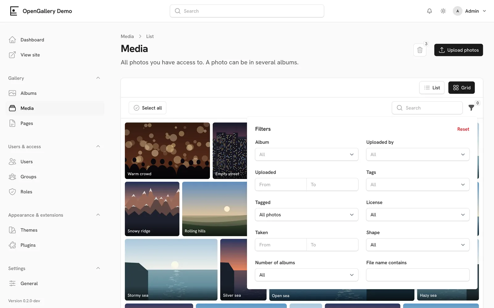
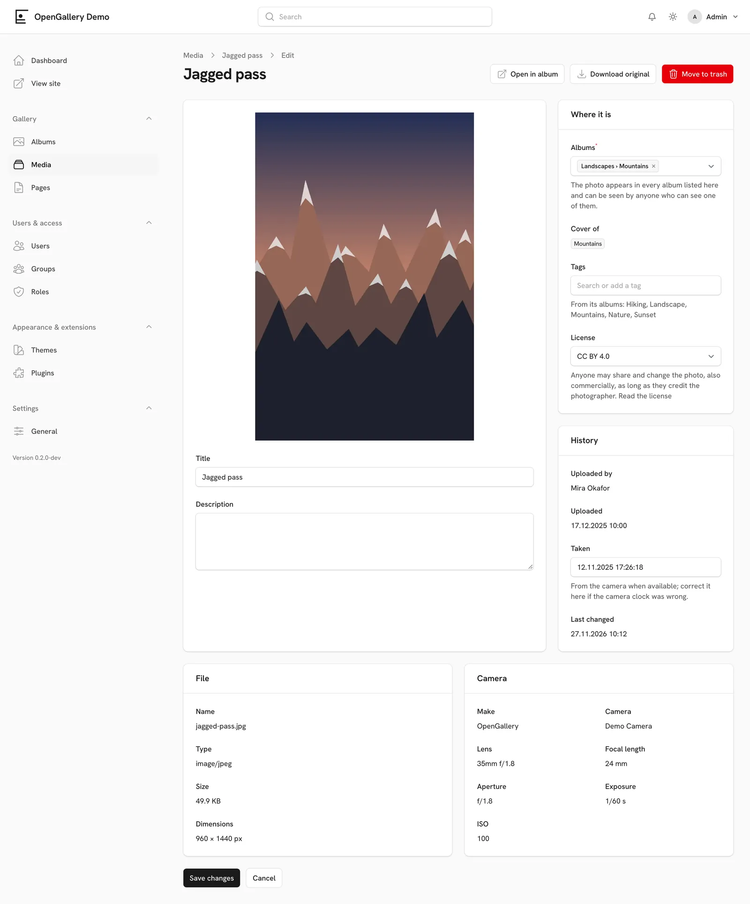
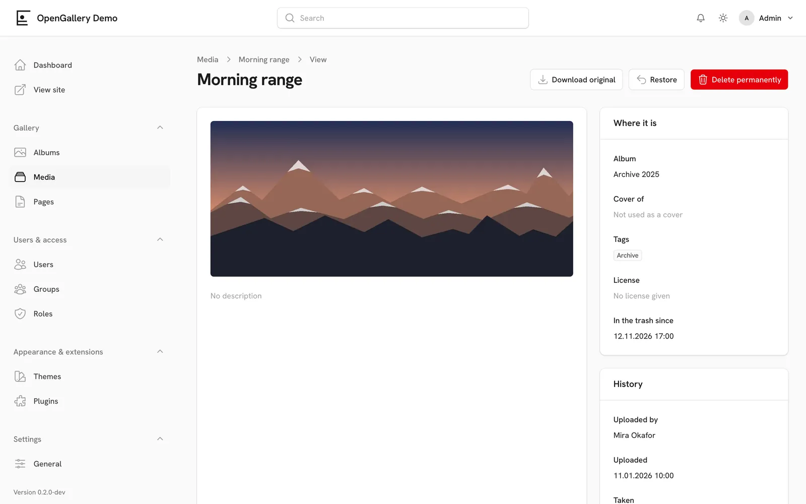

# Photos and the media library

The media library under **Gallery → Media** lists every photo you have access to, across all albums. A photo can be in several albums at once; it is stored only once.

New photos are usually uploaded inside an album: open the album and use **Add photos** (see [Albums](albums.md#adding-photos)). You can also upload here: see [Uploading in the media library](#uploading-in-the-media-library). When photos are uploaded, OpenGallery creates thumbnails and reads the camera data (such as the date taken) automatically.

## Uploading in the media library

Click **Upload photos** at the top (you need the permission "Upload photos"). First choose where the photos go in **Upload to**: "Unsorted uploads" (the default; sort them into albums later) or one of the albums you may add photos to. Click **Continue**, drop the photos on the upload area, and click **Done** when the upload has finished.

The **Upload photos** button on the dashboard opens the same dialog.

While [storage limits](../administration/users-and-permissions.md#storage-limits) are on, a photo that does not fit in your limit is refused with "Not enough storage left. You can store up to 10 GB of photos." Photos in the trash still count until they are deleted for good, so emptying the trash makes room. Ask an administrator if you need more space.

## List and grid

The media library opens as a grid. Switch between the two layouts with the **List** and **Grid** buttons at the right end of the toolbar, in the same row as the search (on a phone they show only icons); the filter chips are right below. Your choice is remembered until you log out.

- **List** shows each photo's thumbnail, title and file name, albums (one badge per album; albums in the trash have a gray badge marked "(in the trash)"), uploader, upload date and size. Photos without a title show "Untitled", and photos that are in no album at all show "In no album" (this should not happen in normal use; add such a photo to an album or move it to the trash). More columns, such as the date taken, can be turned on in the column menu. Long titles, file names, album names and uploader names are cut after 40 characters; hover over them to read the full text. Click an album to open its edit page and click the uploader to open that person's page in the admin. They are plain text when you may not open them: for an album you need to own it or have the permission "Edit any album", for a person the permission "Manage users" and the right to manage that account. Click anywhere else in a row to open the photo; the only icon at the end of the row is **Move to trash** (the red trash can).
- **Grid** shows the photos in rows of equal height, like an album on the site: every photo keeps its shape, so upright photos are shown upright and nothing is cut off. An album's edit page and the photo picker show photos the same way, with the title on the photo. Hover over the title to see the albums the photo is in. A tile marked **Not on the site** belongs only to albums that are in the trash, so visitors cannot see it until one of them is restored. Click a photo to select it; each tile has its own button to open the photo.

## Finding photos

Search by title, or use the filter chips above the list (see [Searching and filtering lists](../getting-started/admin-area.md#searching-and-filtering-lists)). These chips are always shown:

- **Album**: photos in any of the albums you tick. The options show how many photos each album has.
- **Taken**: a date range for the date taken.
- **Tags**: photos that have any of the tags you tick, or **Without tags** for photos with no tag. Only shown while [tagging](tags.md) is on.
- **Uploaded by**
- **Shape**: landscape, portrait or square.

Under **+ More filters** you find the others; each gets its own chip once you set it:

- **Uploaded**: a date range.
- **License**: photos with that [license](licenses.md). Only shown while licenses are on.
- **Number of albums**: photos that are in no album, in one album, or in several.
- **Resolution**: under 2 MP, 2-12 MP or over 12 MP (megapixels).
- **File type**: JPEG, PNG, WebP, GIF, HEIC or AVIF; tick several to see any of them.
- **Missing**: photos that lack any of the details you tick: title, description, date taken and, while licenses are on, license. Use it to find photos that still need captions.
- **My favorites**: only the photos you have marked as a favorite. Other people's favorites are not shown.
- **File name**: part of the uploaded file name.

Photos in the trash are not in the media library; they have their own page (see [The trash](#the-trash)), with the same filters.

The filters are the same in the list and the grid. The photo picker ("Add photos" in an album, choosing a cover or a photo for a page) offers the same chips and the same **+ More filters**, plus one chip for the album you are working on: **Hide photos already in this album** when adding photos, **Only photos in this album** when choosing a cover. That chip is on when the picker opens.

## Working with several photos

Select photos (in the list with the checkboxes, in the grid by clicking them), then open the **Actions** menu and choose an action. In both layouts, **Actions** sits left of **Select all**. **Select all** selects every photo that matches the current search and filters, on all pages, not only the page you see; in the list, the checkbox in the header selects just the photos on the page. Once photos are selected, **Select all** turns into one control that reads "N selected · Select all · ×": click **Select all** again to select more, or the cross to clear the selection. Use the filters first to narrow the library down to the photos you mean.

- **Add to album**: adds the photos to another album, without copying them.
- **New album from selection**: creates a private album of yours with the selected photos (you enter its title) and opens it, where you can choose its cover and how it is shared. Needs the permission "Create albums".
- **Remove from album**: removes them from one album. A photo that would end up in no album is kept; move it to the trash instead.
- **Set license**: gives them a [license](licenses.md); only shown while licenses are on and you may choose a license.
- **Add tags**: adds [tags](tags.md#tagging-many-photos-at-once) to the photos and keeps the tags they have. Only shown while tagging is on.
- **Remove tags**: removes tags from the photos. Only shown while tagging is on.
- **Rename**: gives the photos new titles from a pattern, see [Renaming photos](#renaming-photos).
- **Change uploader**: see [Changing the uploader](#changing-the-uploader). Only shown with the permission "Edit any album".
- **Remove from all albums**: takes the photos out of every album they are in. Because every photo stays in one album, they move to their uploader's "Unsorted uploads" (to yours, if the uploader's account no longer exists), where only the uploader sees them. You need the right to move each photo to the trash.
- **Download**: see [Downloading several photos](#downloading-several-photos).
- **Move to trash**.

Every action only changes the photos you may edit (see [Who may change a photo](#who-may-change-a-photo)). When it leaves some out, the message after it says how many. Each action is recorded as one entry in the [activity log](../administration/activity.md), however many photos it changed.

In the [trash](#the-trash), the choices are **Restore** and **Delete permanently**.

### Renaming photos

**Rename** gives every selected photo a new title made from a pattern. Write the pattern with these placeholders:

- `{n}`: a running number.
- `{title}`: the current title.
- `{original}`: the uploaded file name, without the extension.
- `{album}`: the title of the photo's first album (the one created first), or "Unsorted uploads" only when the photo is in no other album.
- `{uploader}`: the name of the person who uploaded it.
- `{taken}`: the date taken as YYYY-MM-DD, or the upload date when the date taken is unknown.
- `{uploaded}`: the upload date as YYYY-MM-DD.

**Start counting at** sets the first number and **Digits** how many digits it has: with 3 digits the numbers are 001, 002, 003 and so on. The photos are numbered in the order they were taken, and by upload time when the date taken is unknown. A pattern with a placeholder that does not exist is refused, and titles are cut at 255 characters.

Only the title changes. The stored files keep their names; use **Download** to get files named after the titles.

### Changing the uploader

**Change uploader** makes someone else the uploader of the selected photos. Choose the new person by name or email address; only people who may upload photos, and super administrators, are offered. The new uploader can then edit the photos and move them to the trash (see [Who may change a photo](#who-may-change-a-photo)). Photos that were in the previous uploader's "Unsorted uploads" move to the new uploader's.

### Downloading several photos

**Download** gives you one zip file with the originals of the selected photos. The files are named after the photo titles, and the same title twice becomes "Title (1)", "Title (2)" and so on; a photo without a title keeps its file name. Photos you may not download (see [Download original](#a-single-photo)) are left out, and you are told how many. Where the location of a photo is hidden from you, it is removed from the file. The zip is built while it downloads, so it starts at once and needs no background job.

## A single photo

Opening a photo, from the list, the grid, **Your recent uploads** on the dashboard or a link in the [activity log](../administration/activity.md#the-activity-log), takes you to one page for that photo. If you may change the photo, the page is editable and there are no separate "view" and "edit" steps. The buttons at the top of the page are:

- **Open in album** (on the site), for a photo that is in an album that is not in the trash.
- **Download original**, only if you may edit the photo, or downloads are turned on in the [photo settings](../administration/settings.md#downloads) and one of its albums lets visitors download photos.
- **Move to trash**.

The page has two rows. In the first row, the large preview is on the left with the editable **Title** and **Description** below it. On the right:

- **Where it is**: change the **Albums** the photo is in and its [**Tags**](tags.md). **Cover of** is shown for information only. While licenses are on, the **License** field sets its [license](licenses.md). Every photo must stay in at least one album. The photo can be seen by anyone who can see one of its albums.
- **History**: change the **Taken** date (useful when the camera clock was wrong). **Uploaded by**, **Uploaded** and **Last changed** are shown for information only.

The second row has **File** (name, type, size and dimensions) and, next to it, **Camera** (the camera data stored in the file, in two columns), both read-only. A photo without camera data has no **Camera** section, and **File** then uses the full width.

Click **Save changes** to save. You stay on the page. Click an album under **Albums** or **Cover of** to open its edit page, and click the name under **Uploaded by** to open that person's page in the admin. They are plain text when you may not open them: for an album you need to own it or have the permission "Edit any album", for a person the permission "Manage users" and the right to manage that account.

### Read-only photo page

Photos in the trash, and photos you may see but not edit, open the same page read-only: the same layout without editable fields. For a photo in the trash, the page says since when it has been there and offers **Restore** and **Delete permanently** instead of the other buttons (it is only shown to people who could restore it). After **Restore**, someone who may edit the photo lands on its editable page.

## Who may change a photo

- You can edit a photo you uploaded, or a photo in an album you may edit.
- You can move a photo to the trash if you uploaded it, or if you may edit every album it is in.
- You can only add photos to albums you may upload to, and only remove them from albums you may edit.
- You can only add a photo to an album or make it a cover if you may edit that photo. Being able to see it is not enough.

## The trash

**Move to trash** removes a photo from every album it is in and hides it on the site. The trash lists only photos you could restore: your own uploads, and photos all of whose albums you may edit. While it holds such photos, a trash can button with their number (**Trash**) appears at the top of the media library. It opens the trash, which has the same **List** and **Grid** buttons in its toolbar, and the same filters. There you can **Restore** a photo, which puts it back in its albums, or **Delete permanently**, which removes the file for good and cannot be undone. **Back to Media** returns to the library.
