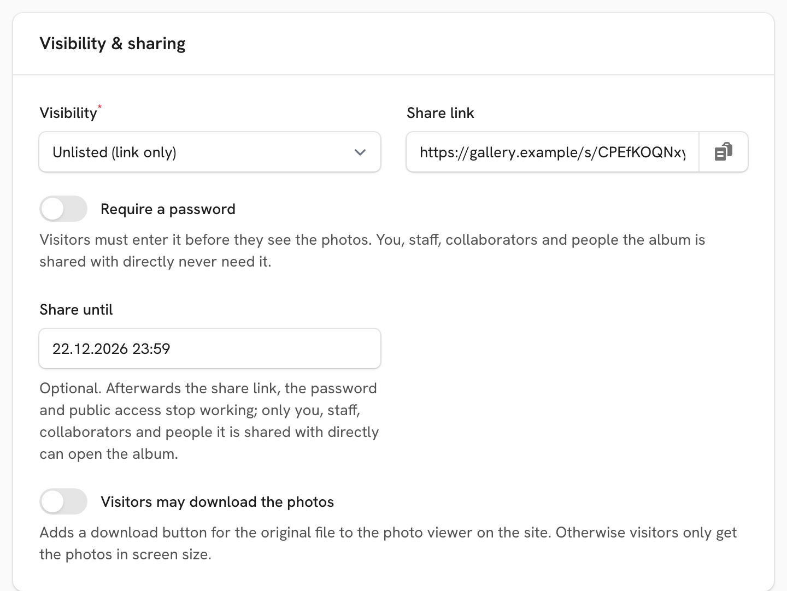
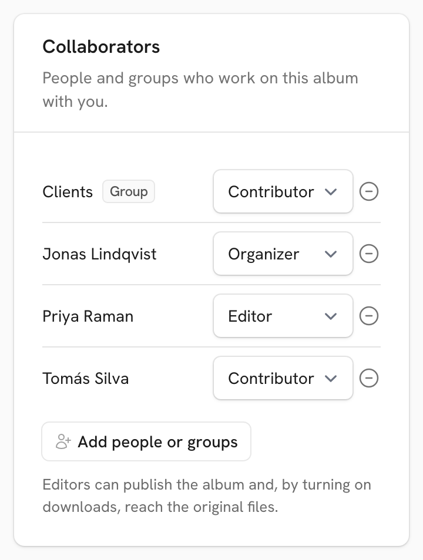
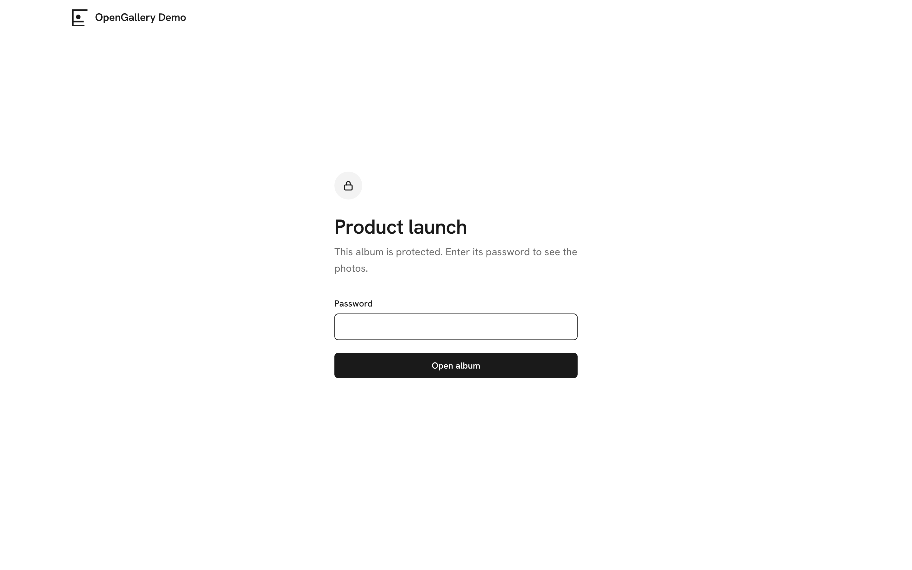

# Sharing albums

Every album has its own visibility, and the photos inside an album can be seen by everyone who can see the album. A photo that is in several albums can be seen by anyone who can see at least one of them.

Visibility and sharing are set in the **Visibility & sharing** section when you create or edit an album.

## Visibility

| Visibility | Who can see the album |
| --- | --- |
| Public | Everyone, including visitors who are not logged in. Listed on the home page. |
| Unlisted (link only) | Everyone who has the share link. Never listed. |
| Registered users | Everyone who is logged in. |
| Specific users & groups | Only the people and groups you share it with. |
| Private (owner only) | Only the owner. |

New albums are private until you change this.

If **Show public albums to visitors who are not logged in** is turned off in the [site settings](../administration/settings.md#access), "Public" albums are only visible to people who are logged in.

Albums inside another album have their own visibility. Set each one separately. The home page only lists top-level albums; albums inside another album are listed on that album's page, and only to people who may see them. An album inside a private album can therefore be visible on its own, but nobody finds it by browsing: send its address or share link instead.

## Who can always open an album

Some people can open an album whatever its visibility, password or end date:

- the album's owner;
- people with the permission "See every album" (by default administrators and moderators);
- people and groups a "Specific users & groups" album is shared with;
- [collaborators](#working-on-an-album-together), whatever the album's visibility.

## Share links for unlisted albums

When you choose **Unlisted (link only)** and save, the album gets a **Share link**. Copy it with the button next to the field, or with **Copy share link** at the top of the album's page on the site, and send it to the people who should see the album. Anyone who opens the link can see the album until they close their browser.

The album opens at the share link's own address, so visitors can pass it on by copying it from the address bar. When the link is sent in a messenger or posted somewhere, the preview shows the album's title and its cover, blurred, with a link symbol; with a password, the cover is blurred beyond recognition and shows a lock instead (see [Link previews](../administration/settings.md#link-previews)). Search engines never list unlisted albums.

Share links keep working even when public albums are turned off for visitors.

Each album has its own link. If you change the visibility from **Unlisted** to something else, the link stops working. Switching back to Unlisted creates a new link, so send it again. People who opened the old link lose access, even in a browser that is still open.

## Sharing with people and groups

With **Specific users & groups**, choose people and groups in **Shared with**. Type part of a name or e-mail address to find people. Groups are offered as soon as you open the list and are marked "(group)". Everyone in a group can see the album, including people who join the group later. Groups are managed under **Users & access → Groups** (see [Users, roles and groups](../administration/users-and-permissions.md#groups)).

Albums shared with someone appear on their "My albums" page under "Shared with you".

With **Tell people when they get access** on (the default), everyone who gains access when you save gets a [notification](../members-and-visitors/notifications.md) in the gallery and, while e-mail works, an e-mail, both with a link to the album: people you added, and members of groups you added. People who already had access, and you yourself, get nothing. E-mails to many people go out in portions, so some can arrive later (see [E-mail settings](../administration/settings.md#e-mail)). People who join a group later can be told when they are added (see [Groups](../administration/users-and-permissions.md#groups)).

## Working on an album together

Sharing lets people look at an album. **Collaborators** can also work on it: add photos, create albums inside it and, depending on their role, change its settings. You can invite people who already have an account, and groups.

### Roles

| Role | What it can do |
| --- | --- |
| Contributor | Sees the album, uploads photos and removes their own uploads. |
| Organizer | Everything above, plus creates sub-albums and removes any photo from the album. |
| Editor | Everything above, plus edits the title, description, cover, photo order, visibility, shared people and groups, password, end date and downloads. |

**Choose Editors with care.** An Editor can publish the album, and by turning on downloads can reach the original files.

No collaborator can change the owner or the list of collaborators, or move the album to another album. They cannot move it to the trash, restore it or delete it either, unless it is a sub-album they created themselves (see below). Collaborators cannot edit other people's photos or see the trash.

### Inviting people and groups

On a new album or an existing one, find the **Collaborators** card next to **Visibility & sharing**. It lists people and groups together. Click **Add people or groups**, search by name, choose a role and click **Add**. Each row has a list to change the role and a button to remove the person or group. On an existing album these changes apply right away, without **Save changes**. On a new album, the people and groups you choose are invited when you click **Create**.

To invite, you need to own the album and have the permission "Invite collaborators", or have the permission "Edit every album". Owners without the permission see the list but cannot change it. System albums have no collaborators.

People you add, and members of groups you add, get a [notification](../members-and-visitors/notifications.md) in the gallery and, while e-mail works, an e-mail. So does someone whose role goes up. People who already had that access, and you yourself, get nothing.

### How roles add up

- A role applies to the album and to every album inside it. If you move an album out, access through the album it was in ends.
- Someone with several roles, directly, through groups or from an album further up, has the highest one.
- A group's role applies to its current members: joining gives the role, leaving ends it.
- Collaborators can always open the album, whatever its visibility, password or end date. Changing the visibility does not remove them.

### Working as a collaborator

Collaborators use the same album pages in the admin as the album's owner, and see what their role allows. People without other admin rights get a reduced admin with only **Albums**: no dashboard, media library, documentation or search. They find it under **Admin** in their account menu, with **Manage albums** on "My albums", or with **Manage album** on the album's page on the site.

The albums list shows the albums you work on, with **Your role**. On an album's page:

| What | Contributor | Organizer | Editor |
| --- | --- | --- | --- |
| Album details and cover | Read-only | Read-only | Can change |
| **Visibility & sharing** | Hidden | Hidden | Can change |
| **Add photos** | Yes | Yes | Yes |
| **Remove from album** | Own uploads | Any photo | Any photo |
| **Add album inside** | No | Yes | Yes |
| List of collaborators | Can see | Can see | Can see |
| **Leave album** | Yes | Yes | Yes |

- **Add photos** opens the usual picker, which shows this album's photos and your own uploads.
- **Remove from album** keeps photos in their other albums. A photo in no other album moves to the "Unsorted uploads" of the person who uploaded it.
- **Add album inside** creates an album that belongs to the owner of the album it is in. It is private until the owner, staff or an Editor publishes it.
- **A sub-album you created** can be moved to the trash, restored and deleted by you, whatever your role, as long as you still work on the album it is in. Deleting it never deletes photos: photos in no other album move to "Unsorted uploads", your own uploads to yours and the rest to the owner's.
- Editors with the permission "Invite collaborators" can search for people and groups to share with. Other Editors can see existing shares and remove them.
- **Leave album** removes your own role. If you still have access through a group or a parent album, the page says so and names it. A role that only comes through a group or a parent album cannot be left here.

Someone who can add to an album only as a collaborator can only add photos they uploaded themselves, also when choosing a cover. Photos of a private album they work on do not appear in their media library unless they uploaded them.

## Password protection

Turn on **Require a password** and enter a password (at least 4 characters). Visitors must enter it before they see the photos. They only need to enter it once per browser session.

- People who can always open the album (see above) never need the password.
- To change the password, enter a new one. Everyone who used the old password is locked out and must enter the new one.
- Turn the switch off to remove the password.

Albums with a password show a lock icon in the albums list. Wrong passwords are recorded in the activity log.

Visitors see the album's title and a password field instead of the photos. After ten tries within a minute they have to wait a moment before trying again.

## Sharing until a date

**Share until** is optional. After this date and time, the share link, the password and public access stop working. Only the people who can always open the album still can. Visitors who open an expired share link see "This link has expired".

The albums list shows "Shared until …" or "Sharing ended …" below the visibility.

Password and end date are not available for private albums.

## Letting visitors download photos

Turn on **Visitors may download the photos** in **Visibility & sharing** to add a download button to the photo viewer on the site and a **Download all** button to the album's page. They download the original files, as they were uploaded; **Download all** puts all of the album's photos into one zip file. Visitors still need to be allowed to open the album: the password and the end date apply to downloads too. GPS positions are removed from their downloads unless this is turned off in the [photo settings](../administration/settings.md#downloads).

The switch is off for every album. While it is off, visitors only get the photos in screen size; the original files stay with the people who may edit the photos. It is not available for private albums.

## When someone may not see an album

People who are logged in but not allowed to open an album get a page saying that it has not been shared with them, with a link back to the gallery. Visitors who are not logged in get "not found", so they cannot tell whether a private album exists.
