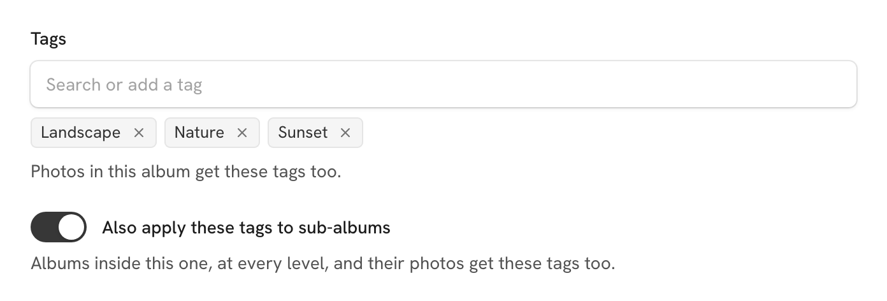
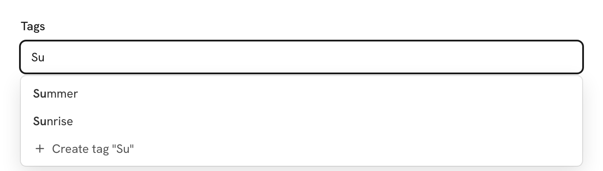
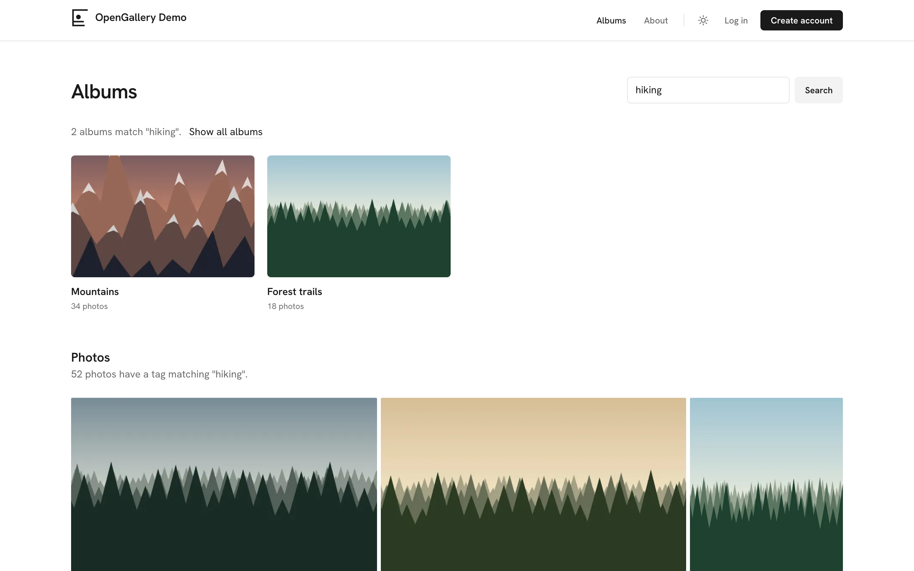

# Tags

Tags are short labels such as "Family" or "Summer 2026". They make albums and photos easy to find through the search on the site, also across albums.

Tagging is on by default. An administrator can turn it off or limit it under [Settings → Tags](../administration/settings.md#tags).

## Adding and removing tags

You can tag what you may edit:

- **Albums**: open the album in the admin, or create a new one, and use the **Tags** field in the **Album** card. Owners, staff and collaborators with the Editor role can change it.
- **Photos**: open a photo in the media library, choose **Edit** and use the **Tags** field. The person who uploaded the photo and people who manage one of its albums can change it.

Click into the field to open a list of existing tags, scroll through it and click one to add it. To create a new tag, type its name and choose **Create tag** in the list, or press Enter or type a comma. Text you leave in the field without confirming it is discarded. To remove a tag, click the **x** on it. Changes are stored when you save the form.

A tag can have up to 50 characters and needs at least one letter or number. An album or photo can have up to 30 tags.

## Reusing existing tags

While you type, the list narrows to matching tags, so typing "Ho" brings up "Holiday". It also finds tags written differently: typing "pet1" shows "Pet 1" and "PET-1". Picking one of them keeps the same thing under one tag, so it is easier to find later. You can also move through the list with the arrow keys and press Enter.

If you want a different tag anyway, press Enter without choosing a row to use what you typed. Only differences in capitals and extra spaces count as the same tag: "pet 1" is added as the existing "Pet 1", while "pet1" would be a new tag.

Which tags you are shown depends on the settings:

- **Predefined tags** are always offered.
- With **Suggest tags from everyone** turned on, you also see every other tag in use.
- With it turned off, you also see your own tags and the tags on albums and photos you can open.
- With **Allow new tags** turned off, you can only choose predefined tags.

## Album tags and their photos

A tag on an album also applies to the photos directly in it. If you remove the tag from the album, or a photo leaves the album, the photo no longer has that tag.

Albums inside the album do not get its tags unless you turn on **Also apply these tags to sub-albums** below the **Tags** field. Then all albums inside it, at every level, and their photos get the tags too. Moving an album out, turning the switch off or removing the tag ends this at once.

The edit pages of a photo and of a sub-album list the tags they get from other albums below the **Tags** field. They can only be changed on the album they come from. You only see tags from albums you can open.

## Finding albums and photos by tag

The search field on the [home page](../members-and-visitors/the-site.md#the-home-page) finds albums and photos by tag. Capitals, spaces and punctuation do not matter, and part of a tag is enough: "pet" finds "Pet 1".

The search only shows what the visitor may open. Albums and photos behind a password are not found by their tags until the password has been entered, and a tag on a private album never reveals a photo that is also in a public album.
