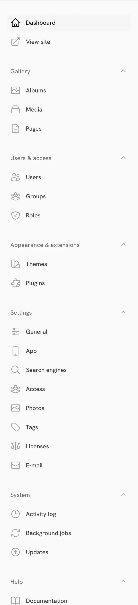
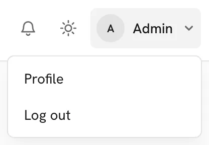
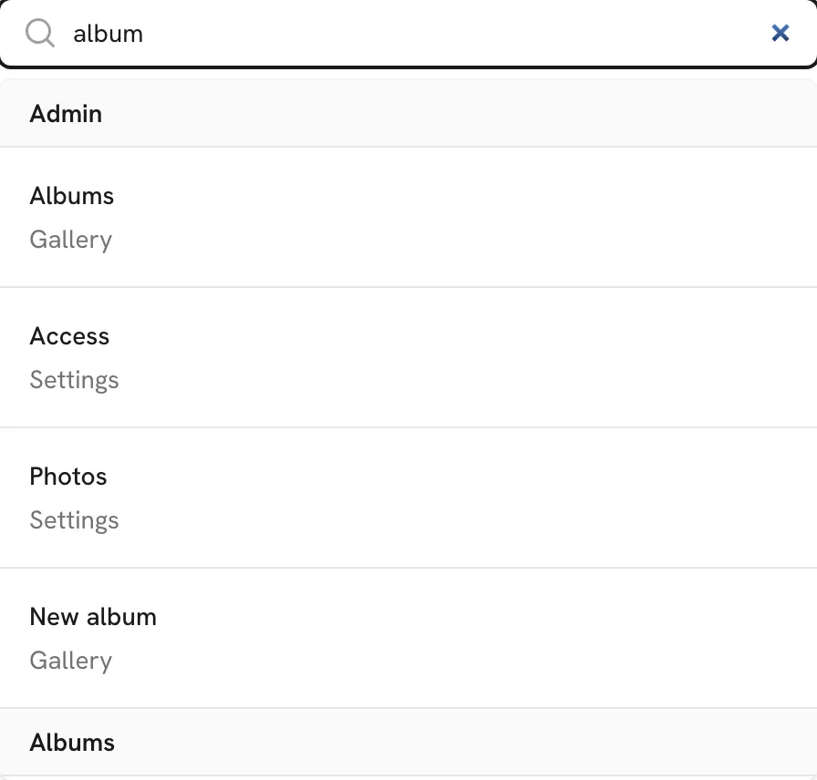
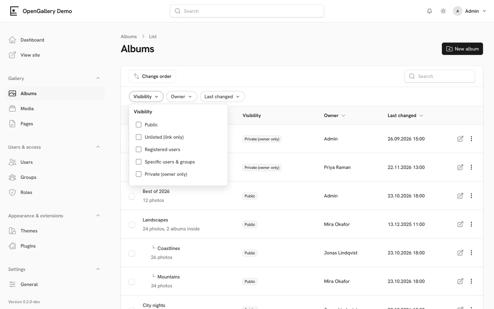

# Finding your way around the admin

The admin area is where albums, photos, pages, people and settings are managed. It is open to everyone with the permission "Open the admin area", by default administrators and moderators.

## Opening the admin

Log in on the site. If you may use the admin, the menu under your picture and name in the site header has an **Admin** entry; you can also go to `/admin` directly. If you are not logged in, `/admin` takes you to the login page first.

## The navigation

The navigation on the left groups the admin's screens. You only see the entries you have permission for, so a moderator sees fewer than an administrator.

Moving between admin pages is quick: only the page changes, without reloading the whole window. Links to the site, to photo files and downloads open as ordinary pages.

| Entry | What it is for | Permission needed |
| --- | --- | --- |
| **Dashboard** | [Panels](../administration/dashboard.md) for what you may do: shortcuts, your albums and uploads, members, pages, site health, activity | Everyone in the admin; each panel needs its own permission |
| **View site** | Opens the site in the same window | |
| **Gallery → Albums** | [Albums](../content/albums.md) | Everyone in the admin (only their own albums without "See every album", "Edit every album" or "Delete every album") |
| **Gallery → Media** | [Photos and the media library](../content/photos.md) | Everyone in the admin; it lists the photos you may see |
| **Gallery → Pages** | [Pages](../content/pages.md) | "Edit pages" |
| **Users & access → Users** | [Accounts](../administration/users-and-permissions.md#users) | "Manage users" |
| **Users & access → Groups** | [Groups](../administration/users-and-permissions.md#groups) | "Manage groups" |
| **Users & access → Roles** | [Roles and permissions](../administration/users-and-permissions.md#roles) | "Manage roles" |
| **Appearance & extensions → Themes** | [Themes](../administration/themes.md) | "Choose and set up themes" |
| **Appearance & extensions → Plugins** | [Plugins](../administration/plugins.md) | "Turn plugins on and off" |
| **Settings → General, App, Search engines, Access, Photos, Storage, Tags, Licenses, E-mail** | [Site settings](../administration/settings.md) | "Change site settings" |
| **System → Activity log** | [The activity log](../administration/activity.md#the-activity-log) | "See the dashboard and activity log" |
| **System → Background jobs** | [Background jobs](../administration/settings.md#background-jobs) | "Change site settings" |
| **System → Updates** | [Updates](../administration/settings.md#updates) | "Change site settings" |
| **System → Test mailbox** | [The test mailbox](../administration/settings.md#the-test-mailbox): e-mails kept instead of sent; only listed while the test mailbox is on or still holds e-mails | Super administrators only |
| **Help → Documentation** | This documentation | Everyone with "Open the admin area" |

Click a group's name to fold it away. Plugin settings have no entry of their own; open them by clicking the plugin's row in the plugins list.

## Your menu, notifications, light and dark mode

The top right corner of the admin looks like the site header. The bell opens your [notifications](../members-and-visitors/notifications.md); a number on it shows how many are new. The sun or moon button switches between light and dark mode; each press flips what is shown. Your choice applies to the site too.

Next to it, your picture (or your initials) and your name open your menu with **Profile** and **Log out**. On a phone only the picture is shown.

To change your name, picture, language or password, use your [profile](../members-and-visitors/profile.md) on the site.

## Searching the whole admin

The search field in the middle of the admin's top bar finds anything you are allowed to open. Click it or press **Ctrl+K** (**Cmd+K** on a Mac) and start typing. Results are grouped:

- **Admin**: screens such as Settings, Themes or Plugins, and shortcuts like "New album" or "New page".
- **Albums**: by title, description or address. You only see albums you may edit.
- **Media**: photos by title, description or file name, with the albums they are in.
- **Pages**, **Users**, **Groups** and **Roles**: by name or title; users also by e-mail address, pages also by their text.
- **Documentation**: guide pages that mention every word you typed, with a short excerpt.

Click a result, or move to it with the arrow keys and press Enter, to open it.

## Searching and filtering lists

Every list in the admin (albums, media, pages, users, groups, roles, the activity log and plugins) works the same way:

- The **search** field in the toolbar searches the list by name or title. In lists with filter chips the toolbar is one row: actions and selection on the left, the search field widening in the middle and the other controls at the right end. On a phone the search field gets its own row.
- Each filter is a **chip** in a row above the list, for example **Album** or **Visibility**. Click a chip to open a small window with its choices: checkboxes where you may pick several (a few lists let you pick only one), and a search field. Lists of albums, people, tags, roles and groups always have one, because they grow over time; other lists get one when they have more than 7 choices. "No matches." appears when nothing fits. For albums, people, tags and similar choices the number next to each option says how many items in the list it covers. **Clear** in the window's header empties that one filter. The list updates as you pick.
- A chip that is set shows its value, for example "Album: Sea +2" (the first choice and how many more) or "Taken: 2025", and a cross. Click the cross to remove that filter. **Reset all** sits at the right end of the row, next to the number of results (for example "15 results"), and shows only while a filter is set; it turns every filter off.
- Date filters (such as **Taken**, **Uploaded** or **When**) offer quick picks: **Last 7 days**, **Last 30 days**, this year and last year. Or fill in **From**, **To** or both.
- Filters you need less often are under **+ More filters**. Once you set one, it gets its own chip.
- A list of related items (all your albums or people) shows only the 100 most used ones, with a note saying so. The search field in the window looks only through the entries listed there (those 100 and the ones you picked), so a very rarely used item may not be found; narrow the list down with other filters or the main search instead. The ones you picked always stay in the list.
- On a phone the chips scroll sideways, and a filter opens as a sheet from the bottom of the screen with a **Show N results** button to close it.
- Lists with a trash (albums and media) show only what is not in the trash. While the trash holds something, a trash can button (**Trash**) with the number of items appears at the top; it opens the trash, which offers **Restore** and **Delete permanently** (and **View** for photos).
- **Move to trash** can be undone from the trash. **Delete** (for pages, users, groups and roles, which have no trash) and **Delete permanently** cannot; their confirmation says so.

The icon in the toolbar, where a list has one, shows or hides columns.

Each row has the same kinds of buttons, in the same order:

- Click a row to open the record. There is no separate **Edit** icon in the lists. Small icons are for other actions, where the list has them: **View on site**, **View** (the eye, for example in the trash) and **Approve**. Hover over an icon to see what it does.
- Then the row's own action, such as **Move to trash**, **Delete** or **Remove**. When a row has several, they are in its **…** menu. The same action has the same icon everywhere, also in menus, for several selected rows and at the top of a record's page: a red trash can deletes or moves to the trash (the confirmation says which), a gray minus sign only unlinks, for example **Remove** takes someone out of a group, and a gray arrow pointing back restores.
- A few actions are written out because they are the reason to open the list: **Approve** (green check mark) for accounts waiting for approval, and **Restore** and **Delete permanently** in the trash.

A cell that can hold several entries, such as a photo's albums or a person's roles and groups, shows each entry as a badge. Single values are plain text; the album's visibility is the one exception, shown as a badge so it is easy to spot. Security events in the activity log are shown in a warning colour with a shield icon.

Names in a list that belong to something else open it when you click them:

- **Albums**: the **Owner** opens that person's page.
- **Media**: an album under **Albums** opens the album, the name under **Uploaded by** opens that person's page.
- **Users**: a role or group badge opens that role or group.
- **Groups** and **Roles**: a picture in the members or users column opens that person's page; so does a name in a group's **Members** or a role's **Users** section.
- **Activity log**: the name under **Who** opens that person's page. Failed logins and lock-outs show "Someone" and are never linked.

Names are plain text when you may not open what they point to: a person's page needs "Manage users" and the right to manage that account, a role needs "Manage roles", a group "Manage groups", and for an album you need to own it or have "Edit any album". Click anywhere else in a row to open the row itself. For users, albums, pages, groups and roles that is their edit page; a photo opens its own page, editable if you may edit it (see [A single photo](../content/photos.md#a-single-photo)).

An empty list says what it is for and offers its first step, for example **New album**. If the search or a filter hides every row, it says "Nothing matches" instead; change the search or the filters.

The media library keeps its search and filters when you switch between list and grid. It has the most filters, for example tags, license, shape, resolution and file name (see [Finding photos](../content/photos.md#finding-photos)); the photo picker in an album ("Add photos") keeps a simpler filter menu behind a funnel icon, with the album, uploader and upload date filters of the media library.

## Finding the documentation

Everyone with the permission "Open the admin area" finds this documentation under **Help → Documentation**, the last entry in the admin navigation.

- **Contents**: on a wide screen the contents are on the left. On a smaller screen or a phone, a bar at the top shows the page you are reading and the section you have scrolled to; tap it to open the contents.
- **Guides**: switch between **User guide** and **Developer guide** at the top of the contents. Each guide is divided into topics; click a topic to fold it open or closed, and **Overview** inside it for its introduction.
- **On this page**: the open page lists its sections below its name, and marks the one you are reading. Click a section to jump to it.
- **Filter pages**: type part of a page title to list matching pages from both guides. The search at the top of the admin also looks inside pages.
- **Screenshots**: click an image to see it larger over the whole window. Click anywhere, use the close button, or press Escape to close it.
- **Previous** and **Next** at the end of a page lead through the guide in order.

Pages open without reloading the screen, so the contents stay where you scrolled them. The address in the browser changes with each page, so you can bookmark or share it, and the browser's back button returns to the page before.
