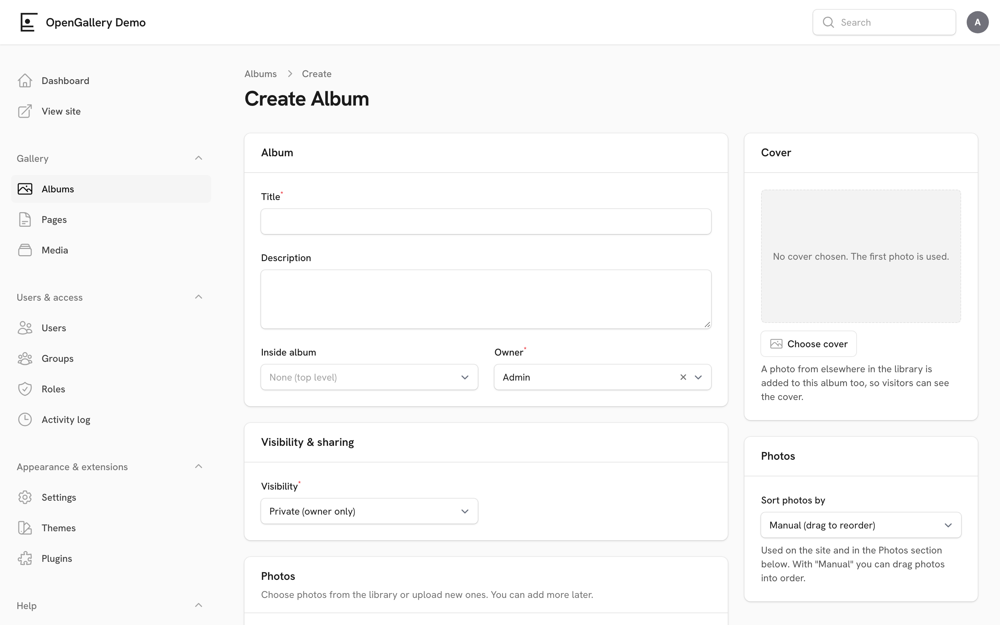
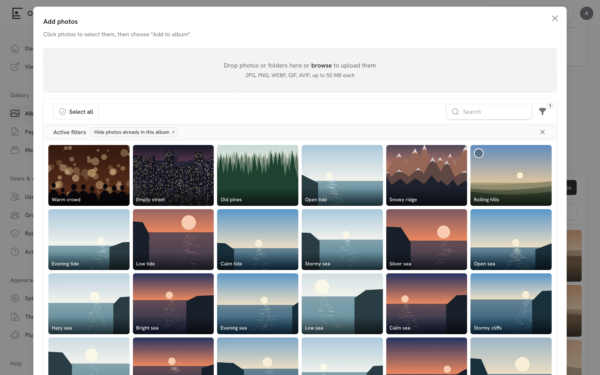

# First steps

Your gallery is installed and you have logged in as the super administrator. This page walks you through the first ten minutes: from an empty gallery to a shared album with a look of your own. Each step links to the page that explains it in full.

A new installation starts empty: there are no albums, pages or other accounts yet, and the Default theme is active. (If you added the demo content during the setup, you can look around it first; see [Demo content](installation.md#demo-content).)

If you set the site name, access and e-mail in the setup, steps 2 and 3 are already done. Look over them anyway: the settings page has more options than the setup.

## 1. Open the admin

After logging in you land on **My albums**, your own page on the site. Click your picture or name in the header and choose **Admin** (or go to `/admin`) to open the admin area. The navigation on the left lists everything you can manage; [Finding your way around the admin](admin-area.md) explains it.

## 2. Name your gallery and set up e-mail

Open **System → Settings**:

- On the **General** page, enter the **Site name** and, if you have one, upload a **Logo** and a **Favicon**.
- On the **E-mail** page, choose how the gallery sends e-mail, fill in your provider's details and click **Send a test e-mail**. Without working e-mail, nobody can reset a forgotten password.
- Click **Save settings** on each page you changed.

All settings are described in [Site settings](../administration/settings.md).

## 3. Decide who may see the gallery

Still in **Settings**, under **Access**:

- **Allow people to create accounts**: leave it on for an open community, turn it off for a family or club where you add every member yourself.
- **Show public albums to visitors who are not logged in**: turn it off if nothing should be visible without logging in. Visitors then see a landing page or the login page instead.

Each album still decides for itself who may see it (step 6).

## 4. Create your first album

Go to **Gallery → Albums** and click **New album**. Enter a **Title**, leave **Visibility** at "Private (owner only)" for now and click **Create**.

## 5. Add photos

On the album's page, scroll to **Photos** and click **Add photos**. Drop photos or whole folders onto the upload area; they go straight into the album. To also add photos that are already in the library, select them and click **Add to album**. Large photos and big batches are fine. See [Adding photos](../content/albums.md#adding-photos).

## 6. Share the album

Back in the album's **Visibility & sharing** section, choose who may see it:

- **Public**: everyone.
- **Unlisted (link only)**: everyone who has the share link. Save, then copy the **Share link** and send it.
- **Registered users**: everyone with an account.
- **Specific users & groups**: only the people and groups you pick.

You can also add a password or an end date. See [Sharing albums](../content/sharing.md).

## 7. Invite people

- To add someone yourself, open **Users & access → Users**, click **New user**, enter their name and e-mail address, and give them a role. With **Send an invitation** on (the default once e-mail works), they get a link to choose their own password; otherwise enter a password for them. "User" lets them see albums shared with them; "Uploader" also lets them create albums and upload photos.
- To share albums with a whole circle of people at once, create a group under **Users & access → Groups** and add the members.

See [Users, roles and groups](../administration/users-and-permissions.md).

## 8. Choose a look

Open **Appearance & extensions → Themes**. Click **Activate** in the row of the theme you want and confirm, then click its row to choose a palette, the header and footer layout, the photo layout and more. See [Themes](../administration/themes.md).

## 9. Add an imprint and a privacy page

Many sites need an imprint and a privacy policy. Create them under **Gallery → Pages** with **New page**, publish them, and pick them under **Pages in the footer** in the theme settings. See [Pages](../content/pages.md).

## 10. Keep an eye on things

- The **Dashboard** shows your library figures and who has been active. See [Dashboard and activity log](../administration/activity.md).
- Choose how the [background jobs](../administration/settings.md#background-jobs) are started, so old activity log entries and unfinished uploads are cleaned up. Cron is the most reliable choice.
- Back up the database and the `storage` folder regularly.

Want to try OpenGallery with sample content first? On a test installation, a developer can load demo albums, people and pages; see [Demo data](../../dev/contributing/demo-data.md) in the developer guide.
