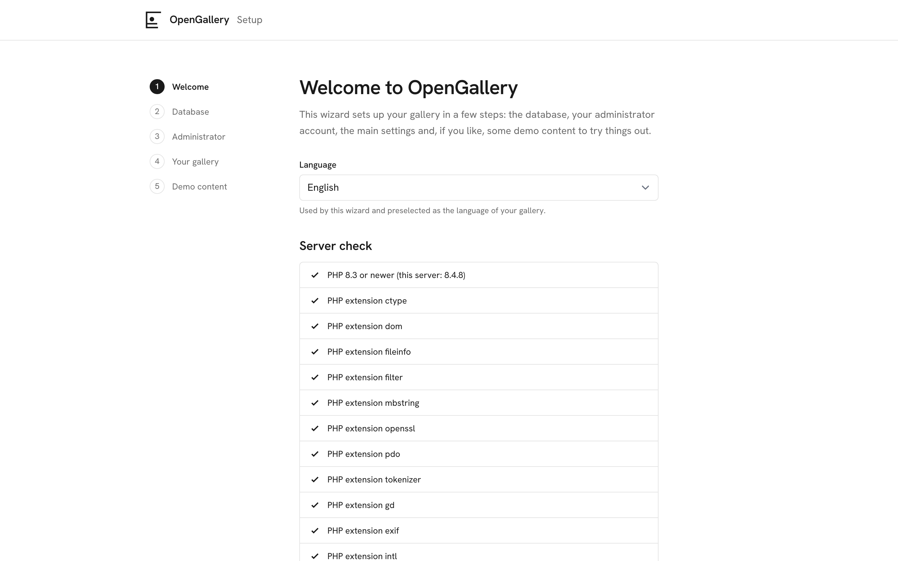

# Installing and upgrading

OpenGallery runs on ordinary PHP web hosting. You do not need Docker, Redis, Node.js or a background worker on the server: everything the gallery needs ships with the release.

## Requirements

- PHP 8.3 or newer with the `gd`, `exif`, `intl` and `zip` extensions, plus the extensions every Laravel application needs (most hosts enable them by default)
- A MySQL or MariaDB database. For trying the gallery out, SQLite (a single file, no database server) works too.
- Optional: the `imagick` extension. It is needed for HEIC photos (the format of many phones). To use it, set `IMAGE_DRIVER=imagick` in the server configuration file.

You do not need a console: the setup runs in the browser. If you have one, you can [install on the command line](#installing-on-the-command-line) instead.

## Installing on shared hosting

1. Download the release zip (`opengallery-<version>.zip`, attached to each release), unpack it and upload the `opengallery` folder to your web space. It already contains everything the gallery needs; do not use the "Source code" downloads, which lack the built styles and scripts.
2. Point your domain's document root at the `public` folder. If your host does not let you change the document root, put the project outside the web root, copy the contents of `public` into the web root and adjust the paths in its `index.php`. On Apache and compatible servers, the main folder refuses direct access if it is exposed by mistake. nginx does not read those rules, so its root must be `public`.
3. Make the `storage` and `bootstrap/cache` folders and the `opengallery` folder itself writable by the web server. The setup saves the server configuration file (`.env`) there.
4. Create a database in your hosting panel and note its server, name, user name and password.
5. Open your gallery's address in a browser. Until the setup is finished, every page leads to the setup at `/setup`. Run through it straight away: until it is finished, anyone who opens the address could do so.

### The setup in your browser



The setup has five steps. The list on the left shows where you are; steps you have finished can be opened again.

1. **Welcome**: choose the language of the setup (it is also preselected for your gallery). The server check lists what the gallery needs. Fix anything marked as missing, for example in your hosting panel, and click **Check again**.
2. **Database**: choose **MySQL** or **MariaDB** and enter the details of the database you created, or choose **SQLite (for trying out)** to keep everything in one file without a database server. The setup checks the connection, saves the details in the server configuration file and creates the tables and the built-in roles.
3. **Administrator**: enter the name, e-mail address and password (at least 12 characters) of the first account. It becomes the super administrator and can do everything; its e-mail address counts as confirmed.
4. **Your gallery**: the site name, the default language, who may see the gallery and create accounts, how e-mail is sent, what starts the background jobs, and whether the gallery [checks for new versions](../administration/settings.md#updates). These are the same options as in [Site settings](../administration/settings.md); you can change them there at any time. If you do not have the e-mail details at hand, keep **Server configuration** and set e-mail up later.
5. **Demo content**: start with an empty gallery, or add demo content to see what OpenGallery can do (see [Demo content](#demo-content)). Click **Finish setup**.

The last page confirms that the gallery is ready. Log in at `/login` with the administrator account you just created. **Admin** in the menu under your name in the site header, or the address `/admin`, opens the admin area. From then on `/setup` no longer exists.

Once the administrator account exists, the setup only continues for the person who created it. Anyone else (or you, after your browser session ended) is asked for the administrator's e-mail address and password first.

If a step stops with an error, the message says why (for example a wrong database password). Fix it and send the step again; nothing is lost.

[First steps](first-steps.md) walks you through the rest of a new gallery.

### Demo content

The demo adds about 30 generated photos in albums that each show a feature (public, private and shared albums, a password, an expiring share link, sub-albums), sample pages, groups, people for every role and a year of activity. Your administrator account takes the administrator's part in it.

The demo accounts (for example `mira@example.com`, an administrator) all have the password `password`. Only add the demo to a gallery for trying things out. If you added it to a gallery on the internet, delete the demo accounts under **Users** right away.

Adding the demo takes up to a few minutes. If your host stops the page before it is done, open the setup again and choose the demo once more: it continues where it stopped.

### Installing on the command line

If you prefer a console (SSH, or your host's console or cron feature):

1. Upload the files as in steps 1 to 3 above.
2. Copy `.env.example` to `.env` and fill it in (see [The server configuration file](#the-server-configuration-file)).
3. Run these two commands once:

   ```bash
   php artisan key:generate
   php artisan gallery:install
   ```

   The installer sets up the database, creates the built-in roles and asks for the name, e-mail address and password (at least 12 characters) of the first super administrator. It also closes the setup in the browser.
4. Log in at `/login` and set up the gallery under **Settings** in the admin menu, in particular **E-mail** (see [Site settings](../administration/settings.md#e-mail)).

If you can only run commands through a cron job or a console that cannot answer questions, give the administrator's details as options:

```bash
php artisan gallery:install --name="Your Name" --email="you@example.org" --password="a long password"
```

Remove the cron job afterwards, because it contains the password.

If you made the `.env` file yourself but its database cannot be reached, the gallery shows an error instead of the setup, so a stranger can never replace your configuration. Correct the database details in `.env`, or delete the file to use the setup in the browser.

## The server configuration file

The `.env` file only holds what the gallery needs before it can reach its database. The setup in the browser creates it for you; you only edit it by hand when you install on the command line or want to change one of the values below. Everything else (site name, language, registration, public albums, e-mail, upload limits, theme, plugins and the activity log) is set in the admin.

| Setting | What to enter |
| --- | --- |
| `APP_ENV` | `production` on a live site (the setup sets it) |
| `APP_DEBUG` | `false` on a live site, so visitors never see error details (the setup sets it) |
| `APP_URL` | The address of your gallery, for example `https://photos.example.org`. Links in e-mails rely on it, so keep it correct. |
| `APP_KEY` | Filled in by the setup or by `php artisan key:generate`. Keep it: it also protects the stored e-mail and sign-in passwords. |
| `APP_LOCALE` | The first default language (`en` or `de`). Change it later in the admin. |
| `DB_CONNECTION`, `DB_HOST`, `DB_PORT`, `DB_DATABASE`, `DB_USERNAME`, `DB_PASSWORD` | Your database details |
| `MAIL_MAILER` | Only used while **Settings → E-mail** is set to "Server configuration". `log` writes e-mails to the log file; the gallery then treats e-mail as not working (no confirmations or notices). To try things out without a mail server, choose **Test mailbox** in the settings instead. |
| `IMAGE_DRIVER` | Leave it out to use `gd`. Set it to `imagick` if your server has that extension and you need HEIC photos. |
| `GALLERY_UPLOAD_CHUNK_KB` | Leave empty. See [Large uploads](#large-uploads). |
| `GALLERY_QUEUE_CONVERSIONS` | Leave at `false`. See [Thumbnails in the background](#thumbnails-in-the-background-optional). |
| `GALLERY_OPTIMIZE` | Leave it out. `false` stops the gallery from preparing its [speed-up files](#prepared-files) by itself. |
| `GALLERY_SENDFILE` | Leave it out. `apache` or `nginx` lets the web server [send the photos](#sending-photos-through-the-web-server-optional). |
| `GALLERY_PLUGINS` | Plugins that are always on, as a comma-separated list of plugin folder names. They cannot be turned off in the admin. |
| `GALLERY_EXTENSION_UPLOADS` | Leave it out. `false` hides **Upload theme** and **Upload plugin** in the admin, so new themes and plugins can only be copied to the server. |
| `GALLERY_TRUSTED_HOSTS` | Only if your gallery has more addresses than `APP_URL` and its www or non-www version: the other host names, separated by commas. |
| `GALLERY_HSTS_MAX_AGE` | Leave it out. How many seconds browsers should keep using HTTPS for your gallery (about six months by default). `0` turns this off. |

A few other `GALLERY_` values exist (for example for registration or public albums). They are only starting values: once the setting is saved in the admin, the admin wins.

## Background jobs

Some housekeeping runs regularly in the background: deleting activity log entries that are older than the retention period, removing uploads that were interrupted and never finished, making the small thumbnails phones use for photos uploaded before they existed, and (only with [thumbnails in the background](#thumbnails-in-the-background-optional)) making waiting thumbnails. Under **System → Background jobs** you choose what starts it (see [Site settings](../administration/settings.md#background-jobs)):

- **AJAX** (the default): runs when someone opens a page. Nothing to set up, but nothing happens while nobody visits the site.
- **Webcron**: an outside service, for example your host's or cron-job.org, opens a secret address every few minutes. The settings page shows the address.
- **Cron** (recommended if your host offers cron jobs): add this cron job in your hosting panel. The settings page shows the line with the real path of your installation:

```bash
* * * * * php /path/to/opengallery/artisan schedule:run
```

A cron job that is set up always works, whichever option is chosen.

## Where photos are stored

Uploaded photos are kept in `storage/app/gallery`, which cannot be reached from the web. Every image is delivered through the gallery, which first checks that the visitor may see it. Logos, profile pictures and theme images are kept in `storage/app/private` the same way.

A visitor's browser keeps the photos it was shown for a day. After that it asks whether a photo changed, and only a changed photo is sent again; the gallery checks access each time. Photos are never kept in shared caches (for example a proxy in front of your host).

Back up the `storage` folder and your database regularly. Together they hold everything: photos, settings, accounts and albums.

## Large uploads

Photos are sent to the server in small pieces, so you can upload large photos and many gigabytes at once even when your host only allows small uploads. The PHP settings `upload_max_filesize` and `post_max_size` only decide how big each piece is.

- The largest single photo is 50 MB by default. Change it in **Settings → Photos** (see [Site settings](../administration/settings.md#uploads)).
- Every photo is turned into a thumbnail and a preview as it arrives. Very large images (many megapixels) need a lot of PHP memory. OpenGallery raises the memory limit for that photo if your host allows it. Otherwise the photo is refused with a message saying how much memory it would need, and you can raise `memory_limit` in your hosting panel.
- If uploads fail with a message about the upload size, your host (or a proxy in front of it) refuses even the small pieces. Set `GALLERY_UPLOAD_CHUNK_KB` to a lower value, for example `1024`.
- Uploads that were interrupted and never finished are removed after a day by the [background jobs](#background-jobs), or with `php artisan gallery:prune-uploads`.

The accepted formats (JPEG, PNG, WebP, GIF, HEIC and AVIF) are chosen in **Settings → Photos**. Only formats your server can turn into thumbnails can be chosen.

## Thumbnails in the background (optional)

By default, thumbnails and previews are made while the photo is uploaded, so no background worker is needed. With `GALLERY_QUEUE_CONVERSIONS=true` in `.env`, uploads finish faster and the thumbnails follow shortly after. They are then made by the [background jobs](#background-jobs), up to 20 seconds per run, or by a queue worker (`php artisan queue:work`) if your server runs one. Use it with cron or webcron: with AJAX, thumbnails are only made while people open pages. All three sizes of a photo are made in one go. While a photo waits, it is not shown on the site yet. **Site health** on the dashboard warns when thumbnails wait longer than 15 minutes or fail. It is worth turning on when uploads of large photos take long or stop with a timeout.

## Speed

How fast the gallery feels depends mostly on three settings of your host. Check them in your hosting panel, or ask your host.

### OPcache

OPcache keeps the gallery's prepared program code in memory. Without it, PHP prepares the gallery anew for every page and every thumbnail, which makes each of them several times slower. Most hosts turn it on; **Site health** on the [dashboard](../administration/dashboard.md#site-health) warns you when it is off. If your panel lets you change its values, these suit the gallery:

| PHP setting | Value |
| --- | --- |
| `opcache.enable` | on |
| `opcache.memory_consumption` | 128 or more |
| `opcache.interned_strings_buffer` | 16 or more |
| `opcache.max_accelerated_files` | 20000 or more |
| `opcache.validate_timestamps` | on, so uploaded updates take effect |
| `opcache.revalidate_freq` | 60 |

### Compression

The gallery's `public/.htaccess` asks the web server (Apache or LiteSpeed) to send pages, styles and scripts compressed, often at a fifth of their size, and lets browsers keep the gallery's style and script files. It needs the modules `mod_deflate`, `mod_filter`, `mod_headers` and `mod_setenvif`, which most hosts have. Where one is missing, that part is skipped and the gallery works as before. On nginx, ask your host to turn on gzip for HTML, CSS, JavaScript and JSON.

### Prepared files

On a live site (`APP_ENV=production`) the gallery prepares a few files in `bootstrap/cache` that make every page and every photo faster. It does so by itself after the first page view, and again after you upload a new release, edit `.env` or turn a plugin on or off. You do not need to run a command. That folder must be writable (see [Installing on shared hosting](#installing-on-shared-hosting)); otherwise **Site health** says **Speed-up files cannot be saved** and the gallery works as before, only slower. To manage these files yourself instead, set `GALLERY_OPTIMIZE=false` in `.env`.

### Sending photos through the web server (optional)

Normally PHP sends every photo itself. On a server you control, the web server can do that instead, once the gallery has checked that the visitor may see the photo. PHP is then free at once, which helps when many people browse at the same time. The photos stay private.

- **Apache** with the module `mod_xsendfile`: allow the storage folder in the server configuration (`XSendFile On` and `XSendFilePath /path/to/opengallery/storage`), then set `GALLERY_SENDFILE=apache` in `.env`.
- **nginx**: add an internal location for the storage folder and set `GALLERY_SENDFILE=nginx`:

  ```nginx
  location /og-storage/ {
      internal;
      alias /path/to/opengallery/storage/;
  }
  ```

  To use another address than `/og-storage`, set it in `GALLERY_SENDFILE_NGINX_PREFIX`.

If photos stop showing after turning it on, the web server is not set up for it: remove the setting again.

### HTTP/2

An album page shows dozens of thumbnails. Over HTTP/2 the browser fetches them side by side instead of a few at a time. Most hosts offer it together with HTTPS, so make sure your gallery runs on `https://`.

## Upgrading

People who manage settings see the installed version at the bottom of the admin menu. While update checks are on, it links to the [Updates page](../administration/settings.md#updates). The gallery can [tell you about new versions](../administration/settings.md#updates). They are also listed on the [releases page](https://github.com/getopengallery/opengallery/releases).

### Installing an update from the admin

Super administrators can install a new version under **System → Updates**:

1. Make your own backup of the database and the `storage` folder. The update makes a database backup too, but only for the time it runs.
2. Click **Install update** and enter your password.
3. Keep the page open. The release is downloaded, checked and unpacked while the gallery stays online.
4. Visitors then see a "Back in a moment" page for a few minutes while the database is backed up, the files are replaced and the database is updated.
5. You return to **System → Updates**, which shows the result.

If any step fails, the previous files and database are put back automatically and the page says what went wrong. Your photos, your server configuration file, your own themes and plugins, and files you added to `public` are never replaced. If you close the page during the update, the gallery restores itself after about 20 minutes, when the next visitor opens it.

The button is not offered when the server cannot update safely, and the page says why. Common reasons are files the web server may not change, too little disk space, or a `public` folder that was moved out of the project. Then upgrade by hand as described below.

If a message says the previous version could not be restored, keep the "Back in a moment" page in place and click **Try again**. If that does not help, restore your own backup, upload the release by hand as described below, then delete `storage/framework/maintenance.php` and the folder `storage/app/updates`.

### Upgrading by hand

1. Back up your database and the `storage` folder.
2. Upload the files of the new release over your installation. Keep your `.env` file and the `storage` folder.
3. Run the installer again:

   ```bash
   php artisan gallery:install
   ```

   It applies database updates and adds new permissions. When a super administrator already exists, it does not create another account.

   It also removes the old `public/robots.txt` file that earlier versions shipped, because the gallery now writes that file's content itself (see [Search engines](../administration/settings.md#search-engines)). If you had changed that file, it is kept and the installer says so: delete it to use the settings instead.

   There is no browser setup for upgrades. Without a console, run the command once as a one-off cron job in your hosting panel. An installed gallery never shows the setup again.

Upgrading keeps the permissions you changed for the built-in roles (admin, moderator, uploader and user) under **Users & access → Roles**. When a new version adds a permission to a built-in role (for example "Open the admin area" for uploaders), the role gets it once; nothing is ever taken away from a role. If you deleted a built-in role, the installer creates it again with its standard permissions.
