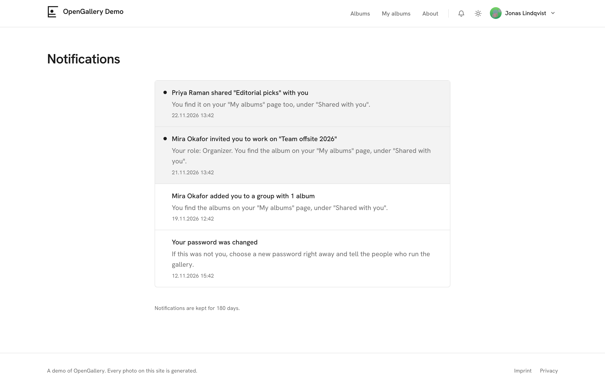

# Notifications

The gallery tells people about things that concern them: an album shared with them, a change to their account, and, for administrators, new accounts and problems with the installation. Every notification is shown in the gallery. Some are also sent by e-mail, but only while e-mail works (see [E-mail settings](../administration/settings.md#e-mail)). Notifications in the gallery appear right away. E-mails to many people go out in portions, so they can arrive later.

## Where to find them

- **On the site**: after logging in, the header shows a bell next to the light/dark switch. A number on it shows how many notifications are new. Click it to open **Notifications**, a list of everything you were told, newest first. Opening the list marks the notifications on it as read; the new ones stay highlighted until you leave the page. Click a notification to go to what it is about.
- **In the admin**: the bell sits in the top bar, before the light/dark switch and your account menu. It opens a panel with the same notifications. Click **Open** on a notification to go to what it is about, **Mark all as read** to clear the number, or **Clear** to remove them all. The panel checks for new notifications every minute while a page is open.

Both bells show the same notifications, so reading one on the site also marks it read in the admin. Notifications are shown in your own language (see [Your profile](profile.md#profile-information)) and are kept for 180 days.

## What you are told about

| Notification | Who gets it | Also by e-mail |
| --- | --- | --- |
| An album was shared with you | People who gain access to an album shared with specific people and groups, when the person sharing leaves **Tell people when they get access** on (see [Sharing albums](../content/sharing.md#sharing-with-people-and-groups)) | Yes |
| A group gave you access to albums | People added to a group who can now see more albums, when the person adding them leaves **Tell people when they get access** on. One notification, however many albums (see [Groups](../administration/users-and-permissions.md#groups)) | Yes |
| You were invited to work on an album | People who get a role on an album or a higher one, directly or through a group, except the person making the change (see [Working on an album together](../content/sharing.md#working-on-an-album-together)) | Yes |
| Someone created an account, or is waiting for approval | People who manage users, while **Tell people who manage users when someone creates an account** is on, and always while new accounts need approval (see [Site settings](../administration/settings.md#access)) | Yes |
| A problem with the installation | People who may change the site settings (see below) | Only for problems that stop the site from working |
| Your password was changed | You, after a change in your profile, with a reset link, or by an administrator (then with their name) | Yes |
| An administrator signed you out on other devices | You, when someone who manages users signs you out of one or more devices. Signing yourself out sends nothing (see [Where you're signed in](profile.md#where-youre-signed-in)) | Yes |
| Your e-mail address was changed | You. The e-mail goes to your **old** address, so you notice if someone else changed it | Yes, to the old address |
| Logging in was blocked for a short time | You, after several wrong passwords for your account. It arrives within a few minutes, at most once an hour | Yes |

A "waiting for approval" notification is marked as read for everyone once someone approves the account, and removed if the account is deleted. Choosing your first password through an invitation does not count as a password change.

If an album is deleted or you lose access to it, its notification no longer shows the album's name or a link. It says that the album is no longer available to you. An e-mail that had not gone out yet is not sent.

If you get a notice about your password or e-mail address that you did not expect, choose a new password right away (**Forgot password?** on the login page) and tell the people who run the gallery.

## Problems with the installation

The [background jobs](../administration/settings.md#background-jobs) repeat the [site health](../administration/dashboard.md#site-health) checks about every five minutes. When a check finds a new problem or warning, everyone who may change the site settings is told once, with a link to what fixes it. Notes (such as "The activity log is off") are not sent. When the problem is gone, its notification is marked as read; if it comes back later, you are told again.

The first check after an update only remembers what it finds, so problems that the dashboard already shows do not all arrive at once.
