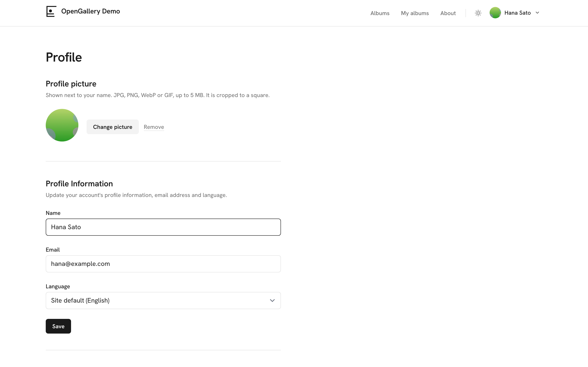

# Your profile

Everyone with an account has a profile page on the site. Once you are logged in, open the menu with your name in the header and choose **Profile**.

 <!-- TODO: re-capture the profile page with the new "Where you're signed in" section -->

## Profile picture

Click **Upload picture** (or **Change picture**), choose a JPEG, PNG, WebP or GIF picture of up to 5 MB and click **Save picture**. It is cropped to a square in the middle and shown in the header, in the admin and next to your name in lists. Without a picture, your initials are shown. **Remove** deletes it again.

Profile pictures are only shown to people who are logged in.

## Profile information

- **Name** and **Email**: how you appear in the gallery and where e-mails, such as password reset links, are sent. To change your e-mail address, you also enter your current password. If you only sign in through another provider, first set a password with **Forgot password?** on the login page. After changing your e-mail address you get a link to confirm the new one, and you need to click it before you can use the gallery again (while the gallery can send e-mail). The old address gets an e-mail about the change, so you would notice if someone else made it (see [Notifications](notifications.md)).
- **Language**: the language of the site, the admin and the e-mails you get. Choose **Site default** to follow the language the administrators chose for the whole site. See [Languages](../administration/languages.md).

Click **Save** to keep your changes.

## Password

Under **Update password**, enter your current password and a new one twice. The new password needs at least 12 characters. You then get a notification, and an e-mail, that your password was changed. Every other device where you are logged in is signed out (see [Where you're signed in](#where-youre-signed-in)).

If you forgot your password, log out and use **Forgot password?** on the login page.

## Where you're signed in

Under **Where you're signed in** you see the browsers where your account is logged in right now. Each one has a short name such as "Firefox on macOS". Sessions that started before the gallery kept these names show as "Unknown device". The browser you are using says **This device**; the others say when they were **Last active**.

- **Sign out** next to a device logs that browser out. It has to log in again the next time it opens the gallery.
- **Sign out all other devices** asks for your password and logs out every browser except this one, including browsers where someone chose "Remember me".

A single **Sign out** does not cancel "Remember me": a browser that was remembered can log itself in again. If you do not recognise a device, use **Sign out all other devices** and choose a new password.

The gallery only stores the short browser and system name, never the full browser details or the IP address. This section is only shown when the gallery keeps its sessions in the database, which is the default. An administrator can also sign you out of your devices; you are then told in the gallery and by e-mail (see [Notifications](notifications.md)).

## Linked accounts

If your gallery offers sign-in with other accounts (see [Plugins and sign-in](../administration/plugins.md#single-sign-on)), the profile page lists them under **Linked accounts**. Click **Link** to connect one; afterwards you can log in with it in addition to your password. Click **Unlink** to remove it.

## Your photos

If you uploaded photos, **Download my photos** downloads all of them (not those in the trash) as one zip file, in folders named after the albums they are in. Photos in several albums appear once, in the folder of their first album. Use it to keep a copy before deleting your account.

## Deleting your account

**Delete account** removes your account permanently. You need to enter your password to confirm.

If you own albums, the dialog lists them and your account is only deleted once you tick **Delete my albums and photos with my account**. Otherwise click **Cancel**: nothing is deleted. To keep your albums, ask an administrator to give them to someone else before you delete your account.

When you confirm, the following is deleted permanently, without going to the trash:

- your albums;
- the photos in them, unless they are also in someone else's album;
- your "Unsorted uploads" and photos you uploaded that are in no album.

Your "Page images" stay, because they are shown on pages.

Albums of other people inside your albums are kept and move up a level. Photos you added to other people's albums stay there.
