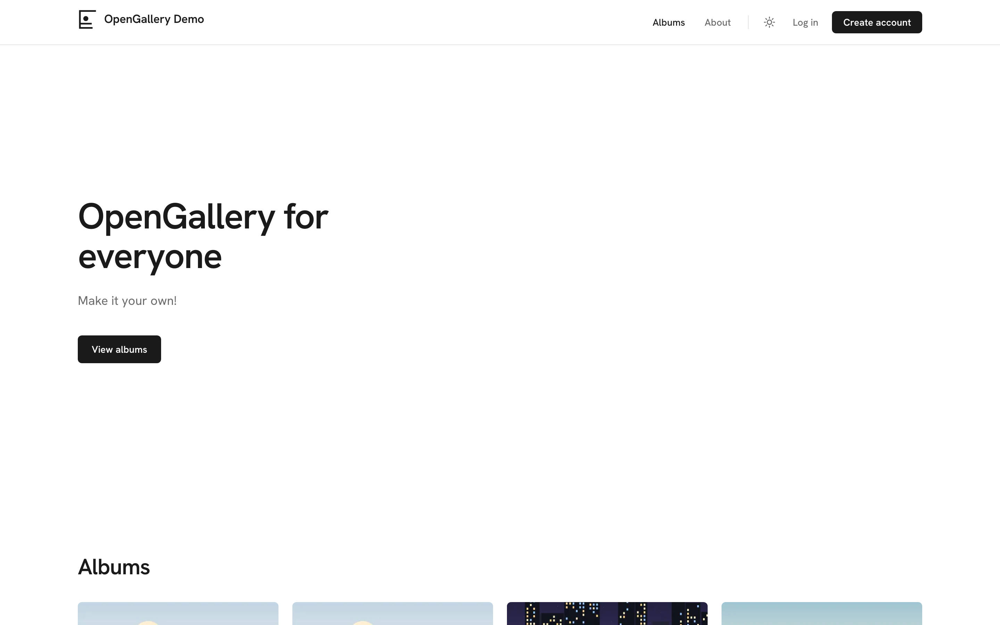
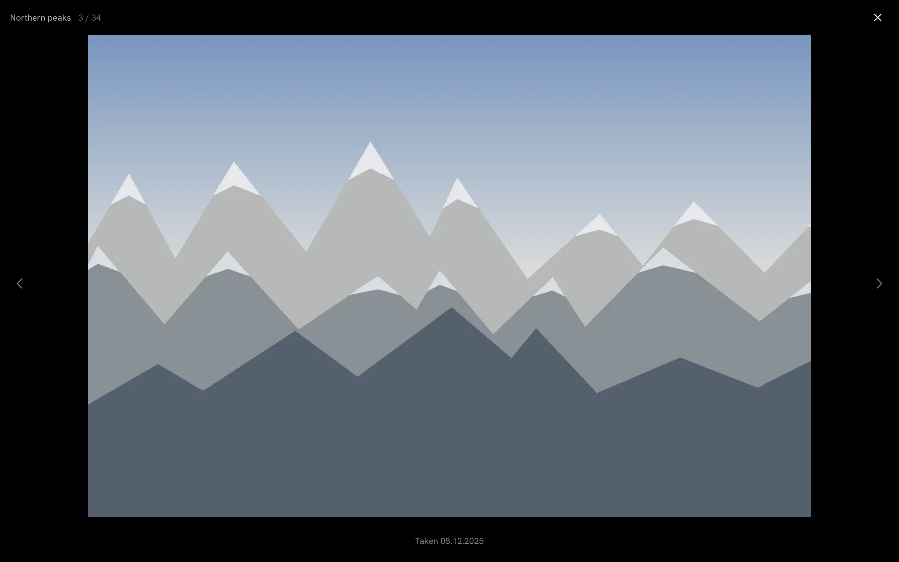
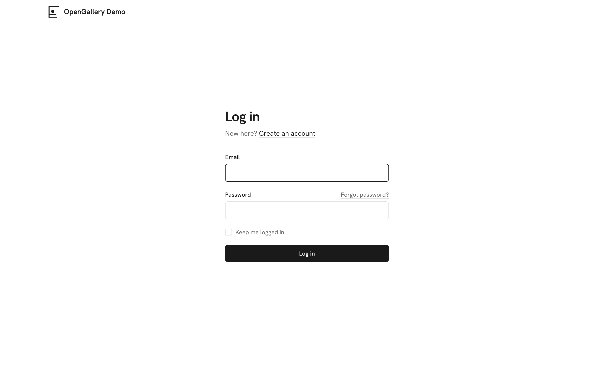
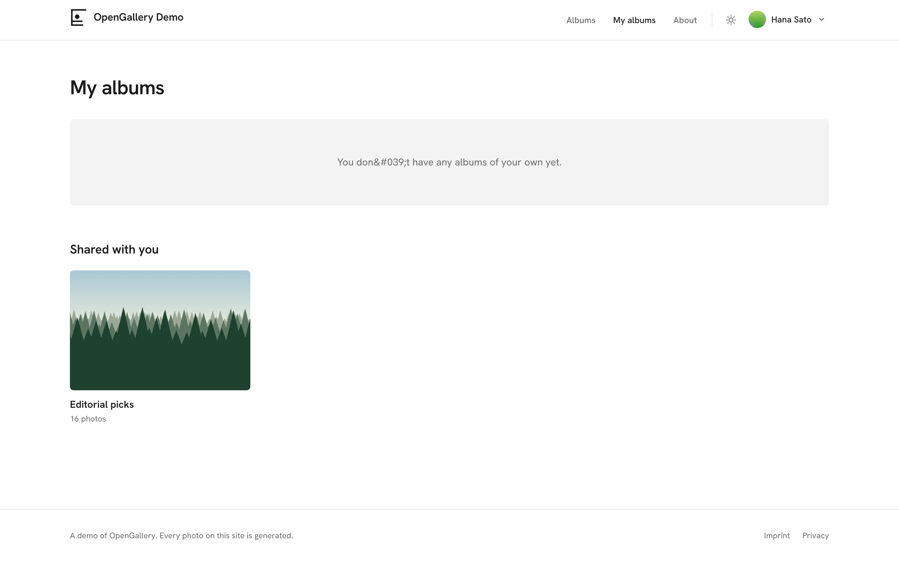

# The site for visitors and members

This page describes what people see on the site, the part of OpenGallery outside the admin: the home page, albums and photos, signing up and logging in, "My albums" and installing the site as an app. How it looks depends on the active [theme](../administration/themes.md); the parts and their names stay the same.

## The header

The header shows the site name or logo, which leads back to the home page, and these links:

- **Albums**: the home page. Shown to everyone while public albums are on, otherwise only after logging in.
- **My albums**: shown after logging in.
- The [pages](../content/pages.md) chosen for the header in the theme settings.
- **Log in** and, while sign-up is open, **Create account**. After logging in, these are replaced by your picture and name, which open a menu with **Profile**, **Admin** (only for people who may open the admin area) and **Log out**.
- After logging in, a bell that opens your [notifications](notifications.md), with the number of new ones.
- A light/dark switch, if the theme settings turn it on.

On small screens the links are collected behind a menu button.

## The home page

The home page lists the top-level albums the visitor may see, 24 per page, with their cover and number of photos. Albums inside other albums are listed on their parent album's page instead.

The search field at the top finds albums by title, description or [tag](../content/tags.md), also albums inside other albums. While tagging is on it also finds photos by tag, shown below the albums. It only finds what the visitor could also reach by clicking through the lists: an album inside an album they may not see stays out of the results. **Show all albums** goes back to the full list.

What visitors who are not logged in see depends on the [site settings](../administration/settings.md#access):

- With **Show public albums to visitors who are not logged in** turned on, they see the public albums.
- With it turned off, they see a landing page or the login page, as chosen in **What visitors who are not logged in see**. The landing page shows a heading, a text, an optional image and buttons to log in and, while sign-up is open, to create an account. Its content and layout are set in the theme settings.

## Albums and photos

An album's page shows its title and description, the albums inside it that the visitor may see (24 per page), and its photos in the album's photo order, 60 per page.

When downloads are turned on for the site and an album lets visitors download photos, everyone who may open it also sees **Download all**, which downloads all its photos as one zip file. People who manage the album also see buttons at the top of its page: **Add photos** (with the permission "Upload photos") opens the album in the admin with the photo picker already open, **Edit album** opens its settings, and for unlisted albums **Copy share link** copies the link to send. Visitors never see these buttons.

Click a photo to view it large, on a dark background with its title and its position in the album (for example "62 / 140", counted across all pages). Below the photo are its description and the date it was taken, when there are any. In this view:

- the arrows on the sides, the left and right arrow keys, or swiping left and right on a phone or tablet move to the next or previous photo;
- tapping or clicking the photo shows the next one;
- after the last photo of a page, the view goes on with the photos of the album's next page (and the other way round at the first photo); closing the view on a photo from another page opens that page of the album;
- the cross, or the Escape key, closes it;
- the download button saves the original file, if downloads are turned on for the site and the album lets visitors download photos (see [Sharing albums](../content/sharing.md#letting-visitors-download-photos));
- the heart, for people who are logged in, adds the photo to your private **Favorites** or takes it out again (see [Favorites](#favorites));
- the **i** button shows or hides a panel with the photo's title, description, the date it was taken and the camera details saved in the file: camera make and model, lens, focal length, aperture, exposure time and ISO. It never shows the location, and the button is missing for photos that have none of these details;
- the play button starts a slideshow that moves on by itself after the number of seconds set by an administrator. Using the arrows or swiping starts the timer again, the space bar plays and pauses, and closing the view stops it.

Administrators can turn the heart, the **i** button and the slideshow off in the photo settings, under [Favorites](../administration/settings.md#favorites), [Photo information](../administration/settings.md#photo-information) and [Slideshow](../administration/settings.md#slideshow).

While a photo is open, the address in the browser points to that photo. Copy it to send someone a link that opens the album at this photo; reloading the page keeps it open too.

If an album asks for a password, visitors enter it once per browser session. If a share link has expired, they see "This link has expired". People who are logged in but may not see an album get a page that says it has not been shared with them, with a way back to the gallery; visitors who are not logged in are told the page does not exist, so they do not learn that the album exists. See [Sharing albums](../content/sharing.md).

## Creating an account

While **Allow people to create accounts** is on in the site settings, the **Create account** link leads to a form for name, e-mail address and password (at least 12 characters, entered twice). New accounts get the role "user": they see public albums, albums for registered users, and albums shared with them or their groups.

When e-mail is set up, the form then asks people to check their inbox, and new members get an e-mail with a link to confirm their address. They open it and log in. If the address already has an account, the form looks the same and the account's owner gets an e-mail about the attempt, so nobody can find out who has an account. Until new members click the link, they only see a page asking them to do so, with a button to send the link again. If the site asks for approval, they then see "Your account is waiting for approval" until an administrator approves them; they get an e-mail when that happens.

While sign-up is closed, the form is not available and only administrators can add people.

People an administrator adds usually get an invitation by e-mail. Its link opens a page to choose a password; after saving it they are logged in. The link works for 7 days; after that, ask an administrator for a new one.

## Logging in

The login page asks for the e-mail address and password. **Remember me** keeps the person logged in on this device. **Forgot password?** sends a link to set a new password to the e-mail address, which needs working [e-mail settings](../administration/settings.md#e-mail). The page gives the same answer whether or not the address has an account. Repeated attempts at logging in, resetting a password or creating accounts are slowed down for a while.

If the gallery offers sign-in with other accounts, the login page also shows a button for each of them, for example "Log in with Keycloak". If one of them is the default login, **Log in** goes straight to that provider; the password form stays available at `/login?local=1`. See [Plugins and sign-in](../administration/plugins.md#single-sign-on).

After logging in, people land on **My albums**, or on the page they were trying to open.

## My albums

**My albums** shows the albums you own and, under **Shared with you**, albums that were shared with you or one of your groups, and albums you [work on as a collaborator](../content/sharing.md#working-on-an-album-together), with your role. Each part shows 24 albums per page.

People who may create albums and open the admin area also see a **New album** button here, which opens the album form in the admin. The same button appears on the home page while it lists no albums.

People who cannot create albums only see the albums shared with them. Until there are any, the page explains that shared albums will appear there.

### Favorites

Once you have liked a photo with the heart in the photo viewer, a **Favorites** tile appears on **My albums**. It opens your favorite photos, the most recently liked first, in the same viewer. Only you can see them. A photo leaves your Favorites when you take the heart off, when it goes to the trash or is deleted for good (for example by its owner), or when you can no longer see it through any album, for example because the album is no longer shared with you.

Liking a photo gives you no extra rights to it: you cannot edit or download it because it is a favorite. Favorites are not an album and cannot be shared.

## Installing the site as an app

Unless an administrator has turned it off (see [Site settings](../administration/settings.md#app)), the site can be installed like an app. It then opens from the home screen or the app list in its own window, without the browser's address bar.

- **iPhone and iPad (Safari)**: tap the share button, then **Add to Home Screen**.
- **Android (Chrome)**: open the menu (three dots) and tap **Add to Home screen** or **Install app**.
- **Computer (Chrome, Edge)**: click the install icon at the right of the address bar, or choose **Install** in the browser menu.

The app shows the same albums as the site and you stay logged in as in the browser. It needs a connection: without one, it shows a short "You are offline" page with a **Try again** button. Photos are not stored on the device, so uninstalling the app removes nothing from the gallery.

## Pages

Published [pages](../content/pages.md), such as an imprint, are at `/pages/` followed by their address. They can be opened even while public albums are off, unless they are for members only. Members-only pages show "not found" to visitors who are not logged in.
